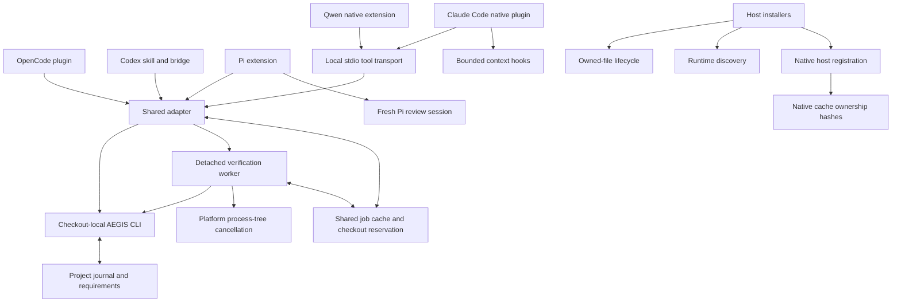

<!--
Copyright (c) 2026 DDP Engineering
Licensed under the PolyForm Noncommercial License 1.0.0; see LICENSE.txt.
SPDX-License-Identifier: LicenseRef-PolyForm-Noncommercial-1.0.0
-->

# Agent integrations

## Purpose

Provide native OpenCode, Codex, Pi, Qwen Code and Claude Code entry points to repository-installed AEGIS without duplicating its contract or durable task state.

## Public interface

OpenCode: Aegis primary agent, two review agents, five /aegis commands, eleven typed tools. Codex: aegis:aegis skill, two installed review-role definitions, local scripts/aegis.mjs operation bridge. Pi: native tools/commands, AEGIS skill and separate read-tool reviewer launcher. Qwen: native extension with skill, commands, two review agents and a local stdio MCP server. Claude Code: native marketplace, five namespaced commands, workflow skill, two Read/Grep/Glob reviewers, bounded advisory hooks and shared local MCP. Package setup exposes install/update/uninstall/doctor. The repository builder assembles complete packages with the existing project version.

## Key behaviors

- REQ-FUNC-ffc5802a and REQ-FUNC-1ca0ff21: backend config-hook registration with existing profile preservation.
- REQ-FUNC-92f78e33: native Codex marketplace/skill discovery and packaged bridge.
- REQ-SEC-16e8890a: independent review prompts and host-dependent read-only controls.
- REQ-DATA-5e4bf048: nearest checkout and its own installed CLI, with schema-1 parsing.
- REQ-REL-0ef6add6: persistent jobs, duplicate prevention, restart recovery and full descendant cancellation.
- REQ-PLAT-a3ae118a and REQ-REL-7a97428b: owned-file installation, backups, native Codex cache hashing, conflict and active-job refusal; installed runtime cache changes require the installer and check both previous and requested cache reservations.
- REQ-PLAT-af657d59: runtime discovery and checks without model requests.

- REQ-FUNC-0549bf24 and REQ-SEC-88bf2840: native Pi operations and fresh reviewer sessions with read tools.
- REQ-FUNC-52d2e370 and REQ-FUNC-f976517c: Qwen native resources and local MCP lifecycle/tool calls.
- REQ-PLAT-81e13664, REQ-REL-2de0ed39 and REQ-PLAT-15c09d6e: five-host assembly and Pi/Qwen owned-file lifecycle.

- REQ-FUNC-10f16f5c, REQ-FUNC-fc5a06d3, REQ-FUNC-f82635e2: native Claude resources, shared stdio transport and bounded context hooks.
- REQ-PLAT-53de04ad and REQ-REL-61e3e7c7: native Claude user registration with owned cache hashing, same-version refresh and failure recovery.

## Architecture

Review prompts guide behavior; effective host permissions remain authoritative. Codex role flags are cooperative checks, not authentication. Jobs preserve uncertainty rather than automatically clearing possible live-process reservations.

## Files

- 05_Software/aegis/integrations/opencode/: plugin entry, config/commands/prompts and installer.
- 05_Software/aegis/integrations/codex/: marketplace, native plugin, skill/reference/role files, script bridge and installer.
- 05_Software/aegis/integrations/pi/: native entry, skill, reviewer launcher/prompts and setup.
- 05_Software/aegis/integrations/qwen/: native manifest, commands/skill/agents, stdio server and setup.
- 05_Software/aegis/tests/test_additional_integrations.py: Pi/Qwen behavior groups.
- 05_Software/aegis/integrations/claude/: native plugin, cache ownership and installer.
- 05_Software/aegis/tests/test_claude_integrations.py: native resources, hooks, protocol and lifecycle regression groups.
- 05_Software/aegis/integrations/shared/: adapter, worker, runtime, bridge, process tree, owned-file lifecycle and vendored libraries.
- 05_Software/aegis/integrations/tests/: behavior tests.
- 05_Software/aegis/tests/test_agent_integrations.py: pytest bridge for configured full verification.
- 02_Tools/build_agent_plugins.mjs: offline standalone package assembly.
- 06_SoftwareDocu/Agent_Plugins.md: install, behavior, distribution and verification boundaries.
