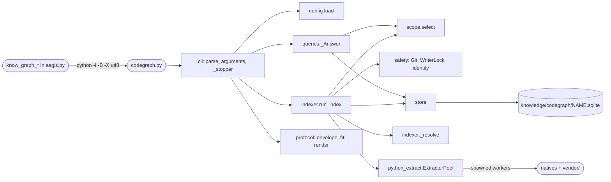

<!--
Copyright (c) 2026 DDP Engineering
This software is licensed under the PolyForm Noncommercial License 1.0.0.
Commercial use requires a separate commercial license.
See the LICENSE.txt in the .agentic folder for full license details.
SPDX-License-Identifier: LicenseRef-PolyForm-Noncommercial-1.0.0
-->

# CodeGraph plugin

## Routing

Read this page when a request mentions CodeGraph, the knowledge graph, code
navigation, the `know_graph*` commands, `[codegraph]` settings, symbol IDs,
reference labels (`direct-syntax`, `lexical-binding`, `candidate`,
`unresolved`, `external`), the index database under
`.agentic/knowledge/codegraph/`, Tree-sitter or the vendored parsers, or
`.agentic/plugins/`. Core dispatch starts at `cmd_know_graph` in
`05_Software/aegis/template/.agentic/aegis.py`, verified by
`05_Software/aegis/tests/test_codegraph_dispatch.py`. Plugin work starts at
`05_Software/aegis/plugins/codegraph/codegraph/cli.py`, verified by the suite
in `05_Software/aegis/plugins/codegraph/tests/`.

Other `aegis.py` commands belong to the Core CLI lifecycle and Validation and
evidence CLI pages; the `AGENTS.md` navigation instruction belongs to the
Reusable workflow payload page. Component pages in `.agentic/knowledge/*.md`
are hand-written knowledge; the generated index folder is unrelated to them.

## Purpose and boundaries

CodeGraph indexes the Python sources selected by `[layout]` into a local
SQLite database and answers bounded questions about definitions, callers and
references. The AEGIS core owns the `know_graph*` commands, the core-validated
`[codegraph]` keys, the time limits, the output cap and response validation;
the plugin in `05_Software/aegis/plugins/codegraph/` owns scope selection,
extraction, storage, write safety and query answers. This repository runs an
installed copy in `.agentic/plugins/codegraph/`.

## Public interface

- Core commands: `know_graph`, `know_graph_check`, `know_graph_find NAME`,
  `know_graph_file PATH`, `know_graph_symbol ID`, `know_graph_callers ID`,
  `know_graph_refs ID` (each with `--json`, `--limit`, `--max-bytes`,
  `--page`) and `know_graph_index [--rebuild] [--json]`. Text output by
  default; `--json` prints the plugin's envelope unchanged.
- Plugin entry: `python -I -B -X utf8 .agentic/plugins/codegraph/codegraph.py
  <operation> --root R [--config C] [--database D] [--protocol 1]
  [--json | --text-envelope] [options] [-- TARGET]`, with operations `scope`,
  `status`, `check`, `find`, `file`, `symbol`, `callers`, `refs`, `index`.
- Protocol v1: one JSON envelope per run with `schema`, `provider`,
  `protocol`, `plugin_version`, `action`, `status`, `reason`, `message`,
  `index`, `freshness`, `indexing_supported`, `python_support`, snapshot
  fields, `results`/`details` or `text`, `has_more`, `next_page`
  (`.agentic/specs/REQ-FUNC-8cb1a3b7.md`).
- Configuration: `[codegraph]` in `.agentic/aegis.toml`; core keys `enabled`,
  `database`, `max_results`, `max_output_bytes`, `timeout_seconds`,
  `check_timeout_seconds`, `index_timeout_seconds`; plugin keys `include`,
  `exclude`, `include_untracked`, `index_tests`, `python_import_roots`,
  `max_file_bytes`, `parse_timeout_seconds`.

## Invariants

- Only the eight `know_graph*` commands start the plugin; disabled or missing
  plugin answers come from the core and start nothing.
- The plugin runs as a child of the same interpreter with `-I -B -X utf8`,
  `shell=False`, the root as working directory, and on POSIX a new session so
  `kill_tree` reaches its descendants; nothing it prints is shown before the
  envelope validates.
- The database is a `NAME.sqlite` file directly inside
  `.agentic/knowledge/codegraph/` after resolving links; both the core and the
  plugin enforce this before any file access.
- Queries and `check` open SQLite read-only and create no file, folder or
  bytecode; only `index` writes, and only inside the storage folder.
- `index` checks, in order: paths and configuration, Git ignored and untracked
  state (before any filesystem change), the writer lock, the database owner
  header, then plugin-content identity; it publishes each generation in one
  transaction, so readers always see a complete generation. A missing
  database, an unsupported schema and a rebuild are built in a temporary file
  that replaces the target only after validation.
- Every query reads inside one transaction, so an answer never mixes
  generations; a page always carries at least one record, and `callers` pages
  linked calls, then candidate calls, as one sequence.
- A `candidate` is never promoted to a link, even with a single match.
- Symbol IDs are the first 32 hex digits of SHA-256 over path, scope, kind,
  name, signature and ordinal (`symbol_id`); a change to extraction output
  raises `EXTRACTOR_REVISION`.
- No child process (Git, extraction workers) receives the watched standard
  input: the watcher reads a private duplicate and standard input becomes the
  null device.
- `vendor/` stays byte-identical to the wheels pinned in `requirements.lock`.

## Change map

| Change requested | Start with | Focused verification |
|---|---|---|
| Core command, limits, validation, exit codes | `cmd_know_graph`, `codegraph_run`, `codegraph_validate` in `aegis.py` | `05_Software/aegis/tests/test_codegraph_dispatch.py` |
| `[codegraph]` keys and defaults | `CODEGRAPH_LIMITS`, `CONFIG_SHAPE`, `DEFAULT_CONFIG`; plugin `codegraph/config.py` | `test_codegraph_dispatch.py`, `tests/test_config.py` |
| Which files are indexed | `codegraph/scope.py` (`select`, `inventory`) | `tests/test_scope.py` |
| Definitions, references, bindings, IDs | `codegraph/python_extract.py` (`_Extractor`, `symbol_id`) | `tests/test_python_extract.py` |
| Labels, candidates, incremental reuse | `codegraph/indexer.py` (`_resolve`, `_publish`) | `tests/test_indexer.py` |
| Locks, recovery, rebuild, Git and identity refusals | `codegraph/safety.py`, `indexer.run_index` | `tests/test_write_safety.py` |
| Query answers, freshness, paging, cited files | `codegraph/queries.py` (`_Answer`) | `tests/test_queries.py` |
| Envelope, text view, budgets, page tokens | `codegraph/protocol.py` | `tests/test_protocol.py` |
| Command line, scope preview, liveness | `codegraph/cli.py` | `tests/test_cli.py`, `tests/test_write_safety.py` |
| Parser version or platform | `codegraph/natives.py`, `vendor/`, `MANIFEST.json`, `requirements.lock` | `tests/test_natives.py`; README "Vendored parsers" |

Paths without a folder are under `05_Software/aegis/plugins/codegraph/`.

## Key behaviors

- `REQ-FUNC-b303507f` — disabled CodeGraph answers `disabled` and starts nothing.
- `REQ-FUNC-f5d5ee3d` — an enabled but missing plugin answers `unavailable` (`plugin_missing`).
- `REQ-FUNC-8b15c62d` — governance commands never start the plugin.
- `REQ-FUNC-b383069e` — the core dispatches each command with fixed arguments and the target after `--`.
- `REQ-SEC-c7e64a0e` — the core confines the database path before dispatch.
- `REQ-REL-53d13fb2` — a plugin over its time limit is stopped with its process tree.
- `REQ-REL-0e1c6d89` — plugin output beyond 64 KiB stops the plugin.
- `REQ-FUNC-e780b270` — a malformed response is a protocol failure and prints nothing.
- `REQ-FUNC-d1994267` — only status `error` exits 1.
- `REQ-FUNC-48ff6d8e` — `know_graph_index` holds the plugin's input open and passes `--watch-stdin`.
- `REQ-UX-8c5b157a` — `AGENTS.md` and `CLI.md` describe when and how to use the commands.
- `REQ-FUNC-29d6c038` — `scope` previews the selection and writes nothing.
- `REQ-FUNC-baa92928` — selection follows the AEGIS layout pattern rules.
- `REQ-FUNC-43a76b41` — an empty scope is reported, not scanned.
- `REQ-FUNC-3a18929b` — inventory comes from Git, else a bounded filesystem walk.
- `REQ-FUNC-c7ece57c` — `pyproject.toml` and `setup.cfg` are found as manifests.
- `REQ-FUNC-0c82c3c6` — module names come from the deepest import root.
- `REQ-FUNC-aa0a867a` — definitions carry kinds, signatures and code-point ranges.
- `REQ-FUNC-7432a8a2` — references are labelled by their resolution evidence.
- `REQ-FUNC-45ed74a5` — syntax errors keep only unaffected top-level facts.
- `REQ-REL-1162622e` — a file over `parse_timeout_seconds` fails and its worker is replaced.
- `REQ-DATA-9004cf27` — symbol IDs are stable 128-bit hashes.
- `REQ-FUNC-e8436251` — ID prefixes resolve uniquely or list the choices.
- `REQ-FUNC-7e74dacf` — unchanged files are reused across runs.
- `REQ-REL-1eeb1914` — each generation is published atomically.
- `REQ-SEC-57e210bb` — indexing refuses storage Git would record.
- `REQ-SEC-135c0df0` — only CodeGraph databases are opened for writing.
- `REQ-REL-6f924213` — one writer at a time, through an operating-system lock.
- `REQ-REL-b96977c7` — readers classify `busy` and `needs_recovery` through SQLite.
- `REQ-REL-4277bfc7` — interrupted writes are recovered only by explicit indexing.
- `REQ-REL-bd1529a5` — rebuild replaces the old file only after validation.
- `REQ-REL-0858819d` — indexing stops when its launcher's input closes.
- `REQ-REL-10dc6424` — a run whose plugin files changed is discarded.
- `REQ-SEC-db558433` — indexing writes only the storage folder.
- `REQ-SEC-68f1bb5d` — direct plugin runs confine the database path too.
- `REQ-FUNC-af6434a9` — queries never write.
- `REQ-FUNC-8cb1a3b7` — status, index state, freshness and capability are separate fields.
- `REQ-FUNC-569a1a97` — unsupported protocol versions are refused with the supported list.
- `REQ-UX-461978be` — compact text by default, JSON on request, quiet standard error.
- `REQ-FUNC-a8ece064` — `status` reports state, scope and the storage folder's Git state.
- `REQ-FUNC-41815b22` — `check` reports `current`, `stale` with paths, or `unknown`.
- `REQ-FUNC-ab604fdb` — `find` ranks qualified name, name, prefix, words, path.
- `REQ-FUNC-a603d692` — `file` outlines one file in source order.
- `REQ-FUNC-d6ef4d32` — `symbol` shows a bounded neighborhood.
- `REQ-FUNC-359c2a92` — `callers` lists linked callers, then ranked candidates.
- `REQ-FUNC-81588d5e` — `refs` lists bound references with labels.
- `REQ-FUNC-ff30861f` — cited files changed since indexing are marked stale.
- `REQ-NFR-17c50caa` — answers stay within record and byte budgets.
- `REQ-FUNC-ff8000c4` — page tokens are bound to the snapshot and request.
- `REQ-PLAT-dc7bdd06` — the binding matching the running Python is selected.
- `REQ-PLAT-3430c1f3` — Windows and Ubuntu produce identical facts.
- `REQ-FUNC-871f7c12` — `check` reports malformed `[codegraph]` settings.

## Architecture

The core sees only the entry point and its envelope. Extraction runs in
spawned worker processes because the parser's progress callback crashes on
Python 3.11 and 3.12, so a per-file timeout can only be enforced by replacing
a worker; queries reuse `scope` for the freshness check.

## Files

- `05_Software/aegis/template/.agentic/aegis.py` — `know_graph*` parsers, `cmd_know_graph`, `codegraph_run`, `codegraph_validate`, `codegraph_settings`, `codegraph_database`, `[codegraph]` config check.
- `05_Software/aegis/plugins/codegraph/codegraph.py` — entry point; no bytecode, own folder first on `sys.path`.
- `05_Software/aegis/plugins/codegraph/codegraph/cli.py` — command line, operations, stdin watcher, progress.
- `05_Software/aegis/plugins/codegraph/codegraph/config.py` — `[layout]` and `[codegraph]` reading, database rule, ingestion digest.
- `05_Software/aegis/plugins/codegraph/codegraph/scope.py` — inventory, selection, skip reasons, manifests.
- `05_Software/aegis/plugins/codegraph/codegraph/python_extract.py` — extraction, bindings, IDs, worker pool.
- `05_Software/aegis/plugins/codegraph/codegraph/natives.py` — binding selection and capability.
- `05_Software/aegis/plugins/codegraph/codegraph/store.py` — schema, headers, reader and writer connections.
- `05_Software/aegis/plugins/codegraph/codegraph/safety.py` — write preconditions, lock, identity, replace.
- `05_Software/aegis/plugins/codegraph/codegraph/indexer.py` — incremental publish, rebuild, label resolution.
- `05_Software/aegis/plugins/codegraph/codegraph/queries.py` — query answers.
- `05_Software/aegis/plugins/codegraph/codegraph/protocol.py` — envelope, views, budgets, page tokens.
- `05_Software/aegis/plugins/codegraph/MANIFEST.json`, `requirements.lock`, `NOTICES.txt`, `vendor/` — version, tested matrix, pinned natives and licences.
- `05_Software/aegis/plugins/codegraph/README.md` — installation, plugin keys, vendoring procedure.
- `05_Software/aegis/tests/test_codegraph_dispatch.py` — core dispatch against a stub plugin.
- `05_Software/aegis/plugins/codegraph/tests/` — `test_config.py`, `test_scope.py`, `test_python_extract.py`, `test_natives.py`, `test_indexer.py`, `test_write_safety.py`, `test_queries.py`, `test_protocol.py`, `test_cli.py`; `conftest.py` runs the entry point with the dispatch flags.
