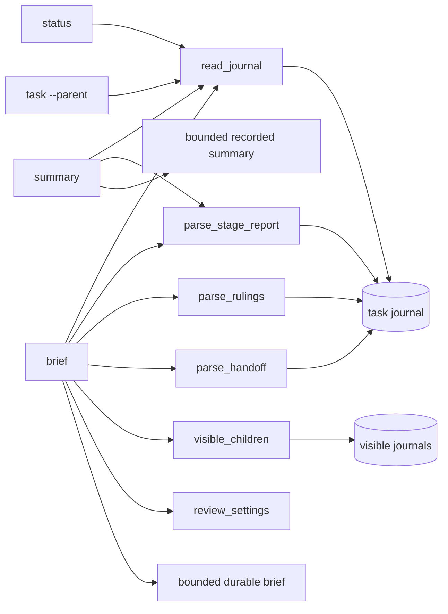

<!--
Copyright (c) 2026 DDP Engineering
This software is licensed under the PolyForm Noncommercial License 1.0.0.
Commercial use requires a separate commercial license.
See the LICENSE.txt in the .agentic folder for full license details.
SPDX-License-Identifier: LicenseRef-PolyForm-Noncommercial-1.0.0
-->

# Core CLI lifecycle

## Purpose

The canonical AEGIS CLI installs repository-owned data areas and scaffolds
durable journals and requirements. It also exposes concise status views so an
operator can find the active task and resume it at the right workflow step.

This component does not itself advance a journal stage, commit, push, or
access the network.

## Public interface

`python .agentic/aegis.py init` completes installation of a copied payload.
`task` creates a feature, fix, change, or adoption journal and can attach one
level of optional child task. `req` creates a
categorized requirement scaffold. `status` lists open journals or displays one
journal by its full or short identifier. `summary` prints a compact recorded
stage view using the same journal lookup plus a strict optional-section
parser; it does not call Git, load configuration, or execute commands.
`brief` adds a deterministic bounded durable re-entry view from the journal,
review policy, rulings, handoff, and child journals visible in the checkout.

## Key behaviors

- `REQ-FUNC-87aea7e9` - Initialize a copied payload while preserving
  repository-owned data and configuration.
- `REQ-FUNC-938600f4` - Create a uniquely identified task journal with the
  repository context needed for later work.
- `REQ-FUNC-5cc0baf7` - Scaffold a categorized, uniquely identified
  requirement record.
- `REQ-FUNC-ac60f1cc` - Show open task state or a selected journal's concise
  resume information.

- `REQ-FUNC-1844e18d` - Render bounded stage snapshots from explicit records,
  preserving missing/stale state and exposing any omitted detail.
- `REQ-FUNC-3bc8597c` - Relate an optional one-level child without mutating its
  parent or claiming visibility beyond the checkout.
- `REQ-FUNC-e55c43d1` - Render a deterministic bounded resume brief without
  commands, Git reads, writes, or inferred approval.
- `REQ-FUNC-7ea14fe4` - Parse durable rulings and stage-bound handoff state for
  compatible journal re-entry.

The optional Stage report is agent-authored, not fresh proof. Stage and result
refer to the reported work, Current comes from the header, and a mismatched
binding suppresses stale claims. Missing values remain not recorded. Invalid
records fail without partial output; shortened output directs full-journal
review before proceeding. Existing status JSON and delivery reports are
unchanged.

## Files

- `05_Software/aegis/template/.agentic/aegis.py` - Canonical CLI
  implementation and argument parser.
- `05_Software/aegis/template/.agentic/templates/task.md` - Task-journal
  scaffold.
- `05_Software/aegis/template/.agentic/templates/requirement.toml` -
  Requirement-record scaffold.
- `05_Software/aegis/tests/test_cli_core.py` - Isolated copied-payload tests
  for lifecycle behavior.
- `05_Software/aegis/tests/test_run_report.py` - Status component-display
  coverage.

## Architecture

Summary and brief compose the shared journal lookup with focused durable-record
parsers. Brief additionally reads workspace review policy and visible journals,
but neither renderer executes configured commands or reads live Git state.

