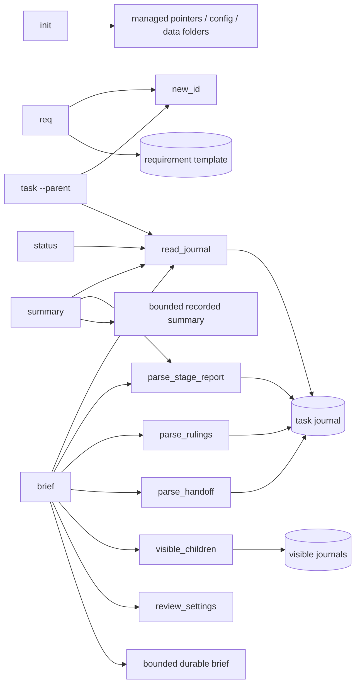

<!--
Copyright (c) 2026 DDP Engineering
This software is licensed under the PolyForm Noncommercial License 1.0.0.
Commercial use requires a separate commercial license.
See the LICENSE.txt in the .agentic folder for full license details.
SPDX-License-Identifier: LicenseRef-PolyForm-Noncommercial-1.0.0
-->

# Core CLI lifecycle

## Routing

Read this page when a request mentions `init`, `task`, `req`, `status`,
`summary`, `brief`, task-header parsing, rulings, handoffs, visible child tasks,
or installation of the copied core payload. Start implementation inspection in
`05_Software/aegis/template/.agentic/aegis.py` at the matching `cmd_<command>`
entry point or the symbol named in the Change map. Start focused verification
in `05_Software/aegis/tests/test_cli_core.py`; summary, brief, and extended
status behavior also lives in `test_run_report.py`.

Requests about `check`, configured test execution, reports, anchors, evolution,
diagrams, trace exports, or path explanations belong to the Validation and
evidence CLI page even though those commands share `aegis.py`. Requests that
change the workflow steps or artifact templates belong to the Reusable
workflow payload rather than this CLI component.

## Purpose and boundaries

The canonical AEGIS CLI installs repository-owned data areas and scaffolds
durable journals and requirements. It also exposes concise status views so an
operator can find the active task and resume it at the right workflow step.

This component does not itself advance a journal stage, commit, push, or
access the network.

## Public interface

`python .agentic/aegis.py init` completes installation of a copied payload.
`task` creates a feature, fix, change, or adoption journal and can attach one
level of optional child task. `req` creates a
categorized requirement scaffold. `status` lists open journals or displays one
journal by its full or short identifier. `summary` prints a compact recorded
stage view using the same journal lookup plus a strict optional-section
parser; it does not call Git, load configuration, or execute commands.
`brief` adds a deterministic bounded durable re-entry view from the journal,
review policy, rulings, handoff, and child journals visible in the checkout.

## Invariants

- `init` preserves repository-owned data and configuration, and a second run
  over a complete installation is byte-for-byte idempotent.
- `task` and `req` use collision-resistant repository-local identifiers and
  preserve their canonical template structure.
- `status`, `summary`, and `brief` are read-only views; they do not advance a
  stage, execute configured commands, commit, publish, or access the network.
- Missing recorded evidence remains `not recorded`; malformed, stale, or
  mismatched stage reports never become success or approval claims.
- Child relationships are one level deep, recorded only on the child, and
  discovered only from journals visible in the current checkout.
- Bounded output never replaces required full-journal or step-file reads.

## Change map

| Change requested | Start with | Focused verification |
|---|---|---|
| Copied-payload initialization or managed pointers | `cmd_init` and its initialization helpers | the `test_init_*` group in `test_cli_core.py` |
| Task or requirement scaffolding and identifiers | `new_id`, `cmd_task`, `cmd_req` | the `test_task_*`, `test_req_*`, and parent/child groups in `test_cli_core.py` |
| Status lookup or task-header display | `read_journal`, `cmd_status` | status groups in `test_cli_core.py` and `test_run_report.py` |
| Recorded stage summary | `parse_stage_report`, `cmd_summary` | the `test_summary_*` group in `test_run_report.py` |
| Durable resume brief, rulings, handoff, or children | `parse_rulings`, `parse_handoff`, `visible_children`, `review_settings`, `cmd_brief` | the `test_brief_*`, ruling, handoff, and child groups in `test_cli_core.py` and `test_run_report.py` |

## Key behaviors

- `REQ-FUNC-87aea7e9` - Initialize a copied payload while preserving
  repository-owned data and configuration.
- `REQ-FUNC-938600f4` - Create a uniquely identified task journal with the
  repository context needed for later work.
- `REQ-FUNC-5cc0baf7` - Scaffold a categorized, uniquely identified
  requirement record.
- `REQ-FUNC-ac60f1cc` - Show open task state or a selected journal's concise
  resume information.

- `REQ-FUNC-1844e18d` - Render bounded stage snapshots from explicit records,
  preserving missing/stale state and exposing any omitted detail.
- `REQ-FUNC-3bc8597c` - Relate an optional one-level child without mutating its
  parent or claiming visibility beyond the checkout.
- `REQ-FUNC-e55c43d1` - Render a deterministic bounded resume brief without
  commands, Git reads, writes, or inferred approval.
- `REQ-FUNC-7ea14fe4` - Parse durable rulings and stage-bound handoff state for
  compatible journal re-entry.

The optional Stage report is agent-authored, not fresh proof. Stage and result
refer to the reported work, Current comes from the header, and a mismatched
binding suppresses stale claims. Missing values remain not recorded. Invalid
records fail without partial output; shortened output directs full-journal
review before proceeding. Existing status JSON and delivery reports are
unchanged.

## Files

- `05_Software/aegis/template/.agentic/aegis.py` - Canonical CLI
  implementation and argument parser.
- `05_Software/aegis/template/.agentic/templates/task.md` - Task-journal
  scaffold.
- `05_Software/aegis/template/.agentic/templates/requirement.toml` -
  Requirement-record scaffold.
- `05_Software/aegis/tests/test_cli_core.py` - Isolated copied-payload tests
  for lifecycle behavior.
- `05_Software/aegis/tests/test_run_report.py` - Extended status, summary, and
  brief behavior coverage.

## Architecture

Summary and brief compose the shared journal lookup with focused durable-record
parsers. Brief additionally reads workspace review policy and visible journals,
but neither renderer executes configured commands or reads live Git state.

