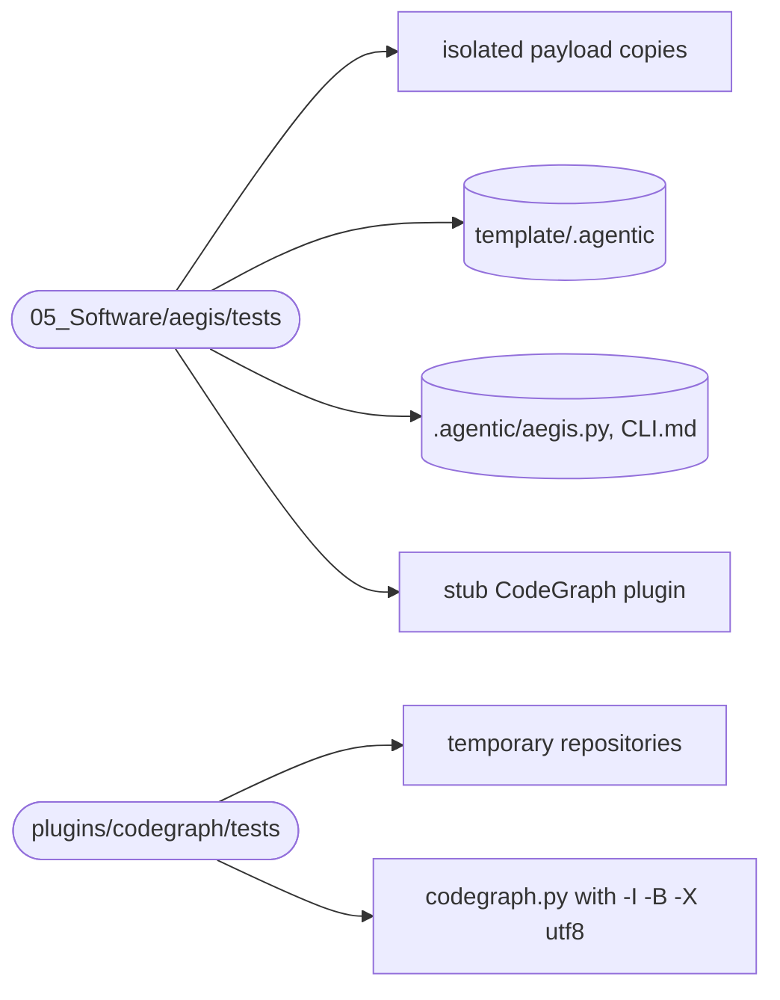

<!--
Copyright (c) 2026 DDP Engineering
This software is licensed under the PolyForm Noncommercial License 1.0.0.
Commercial use requires a separate commercial license.
See the LICENSE.txt in the .agentic folder for full license details.
SPDX-License-Identifier: LicenseRef-PolyForm-Noncommercial-1.0.0
-->

# Product verification suite

## Routing

Read this page when a request is about how the AEGIS product is tested: the
suites, their fixtures, how to run them, or where a new test belongs. The core
suite lives in `05_Software/aegis/tests/`; the CodeGraph plugin's own suite
lives in `05_Software/aegis/plugins/codegraph/tests/`. Start with the test file
named for the behavior under Files.

The behavior a test protects belongs to its component page - Core CLI
lifecycle, Validation and evidence CLI, Reusable workflow payload, Agent
integrations, Release builder, or CodeGraph plugin.

## Purpose and boundaries

The AEGIS product suites protect the canonical copied payload, its CLI
contracts, the host integrations and the CodeGraph plugin. They use temporary
repositories, deterministic Git fixtures where available, configured child
commands, and structural source inspections. They verify the product; they do
not govern a live repository or modify the canonical payload under test.

## Public interface

- Core suite: `python -m pytest -q 05_Software/aegis/tests`, also run by
  `python .agentic/aegis.py test` through `[commands] test`.
- Plugin suite: `python -m pytest -q 05_Software/aegis/plugins/codegraph/tests`,
  run by `check --run` through `[commands] codegraph_test`. The two suites run
  separately because each has its own import setup.
- Lint: `python -m ruff check 05_Software/aegis` through `[commands] lint`.

## Invariants

- Tests run against temporary copies; they never write the canonical payload,
  the installed `.agentic/` records, or the plugin folder under test.
- The structural suite compares the installed CLI and reference against the
  canonical template and derives required reference sections from the
  parser's actual commands.
- Documentation under `06_SoftwareDocu/` is inspected directly, without prose
  or layout assertion tests.
- Plugin tests that assert nothing was written run a fresh copy of the plugin
  folder, so no earlier import or edit can affect the result.

## Key behaviors

- `REQ-TEST-2b78f69d` - Exercise core CLI behavior in isolated payload copies.
- `REQ-TEST-2651b9cf` - Exercise governance and evidence behavior with
  deterministic fixtures.
- `REQ-TEST-e38913a7` - Guard reusable payload structural constraints.
- CodeGraph behavior is verified by the tests linked from its requirements;
  see the CodeGraph plugin page (no req for the suite itself).

## Architecture

Temporary repositories isolate command behavior and record validation;
structural checks read the canonical template directly, and the installed-copy
guard also reads this repository's `.agentic/aegis.py` and `.agentic/CLI.md`.

## Files

- `05_Software/aegis/tests/test_cli_core.py` - lifecycle and scaffold tests.
- `05_Software/aegis/tests/test_check.py` - governance-check catalog tests and
  shared temporary Git fixtures.
- `05_Software/aegis/tests/test_run_report.py` - command, strict-mode, report,
  JSON, and configuration tests.
- `05_Software/aegis/tests/test_repo_evolution.py` - anchor and evolution
  record tests.
- `05_Software/aegis/tests/test_focused_verification.py` - impacted-test
  selection, non-executing previews, and lean scaffolds.
- `05_Software/aegis/tests/test_structure.py` - payload invariant tests.
- `05_Software/aegis/tests/test_codegraph_dispatch.py` - `know_graph*`
  dispatch against a stub plugin.
- `05_Software/aegis/tests/test_release_builder.py` - release builder
  characterization tests.
- `05_Software/aegis/tests/test_agent_integrations.py`,
  `test_additional_integrations.py`, `test_claude_integrations.py` - host
  integration behavior without model requests.
- `05_Software/aegis/plugins/codegraph/tests/` - the CodeGraph plugin suite;
  `conftest.py` holds its repository and entry-point helpers.
