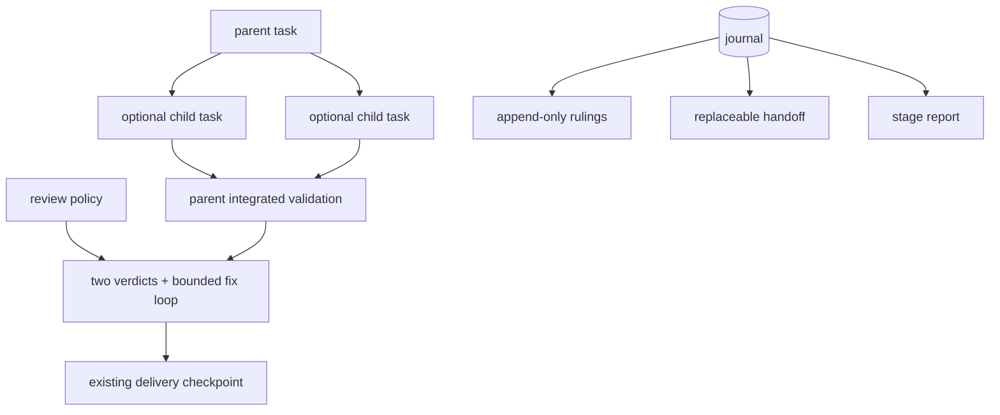

<!--
Copyright (c) 2026 DDP Engineering
This software is licensed under the PolyForm Noncommercial License 1.0.0.
Commercial use requires a separate commercial license.
See the LICENSE.txt in the .agentic folder for full license details.
SPDX-License-Identifier: LicenseRef-PolyForm-Noncommercial-1.0.0
-->

# Reusable workflow payload

## Purpose

The canonical payload is the generic, copyable AEGIS workflow distributed to
other repositories. It contains the operator contract, task stages, adoption
procedure, artifact templates, CLI reference, and implementation, but no
repository-specific development history or policy.

## Public interface

Downstream repositories copy `template/.agentic/` to `.agentic/` and run
`python .agentic/aegis.py init`. Agents use `AGENTS.md` and the stage files to
perform ordinary work or component-by-component adoption, while the templates
define durable artifact formats.

## Key behaviors

- `REQ-FUNC-d60b322b` - Guide ordinary work through separated workflow stages.
- `REQ-FUNC-32fe33a0` - Guide component-by-component repository adoption.
- `REQ-FUNC-b8f0efc5` - Provide durable workflow artifact templates.
- `REQ-PLAT-e675406e` - Ship a complete self-contained offline workflow
  payload.
- `REQ-UX-ccb4ca06` - State each recorded deviation in the conversation when
  it happens, in both interaction modes, without pausing the work.

- `REQ-FUNC-500cfb8b` - Carry each component's architecture diagram in
  its knowledge page, drawn at adoption and revised at design.

- `REQ-UX-84868466` - Present a consistent report on completion or pause
  without adding approval gates or deferring deviation notices.
- `REQ-UX-94a33d75` - Resume from compact reporting and relevant durable
  records while preserving required full reads and unresolved issues.
- `REQ-FUNC-3bc8597c` - Keep optional child work one level deep, independently
  governed, and integrated by its visible parent candidate.
- `REQ-FUNC-e55c43d1` - Start re-entry with a deterministic bounded brief.
- `REQ-FUNC-9514e017` - Record two optional independent review verdicts.
- `REQ-FUNC-cbff6478` - Bound fix and re-review cycles before human escalation.
- `REQ-FUNC-7ea14fe4` - Preserve append-only rulings and a replaceable handoff.

Every stage file includes brief-first resume, report, ruling, and handoff
reminders. The task template provides compatible parent and review fields,
append-only rulings, one replaceable handoff, and a replaceable latest report
beside the append-only log. Explicit one-stage prompts end after recording the
outcome; normal checkpoint/autopilot flows retain their approval rules.

## Files

- `05_Software/aegis/template/.agentic/AGENTS.md` - Workflow contract and
  operator prompts.
- `05_Software/aegis/template/.agentic/CLI.md` - CLI contract and examples.
- `05_Software/aegis/template/.agentic/steps/` - Ordinary-work and adoption
  procedures.
- `05_Software/aegis/template/.agentic/templates/` - Durable artifact
  scaffolds.
- `05_Software/aegis/template/.agentic/LICENSE.txt` - Payload license.
- `05_Software/aegis/tests/test_structure.py` - Payload invariants and
  structural regression tests.

## Architecture

The payload keeps one six-stage workflow. Optional children are ordinary
one-level tasks, while durable rulings, a current handoff, and optional bounded
review state enrich the existing journal without adding a stage or service.

