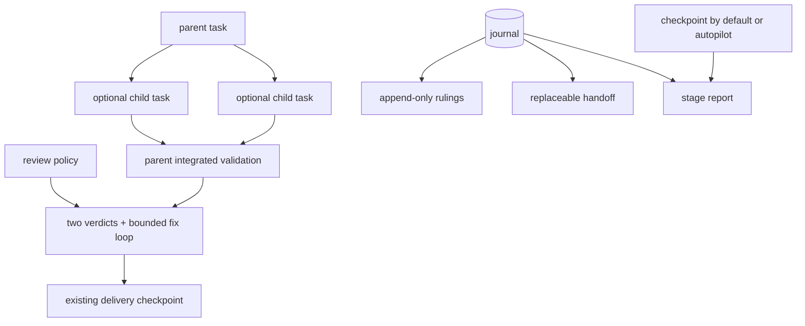

<!--
Copyright (c) 2026 DDP Engineering
This software is licensed under the PolyForm Noncommercial License 1.0.0.
Commercial use requires a separate commercial license.
See the LICENSE.txt in the .agentic folder for full license details.
SPDX-License-Identifier: LicenseRef-PolyForm-Noncommercial-1.0.0
-->

# Reusable workflow payload

## Routing

Use this page for core workflow stages, adoption, artifact scaffolding, current
project context, and resume guidance. Start with
`05_Software/aegis/template/.agentic/AGENTS.md` and the affected step/template;
CLI scaffolding and brief rendering live in `aegis.py`. Focused verification
starts in `test_cli_core.py`, `test_run_report.py`, and `test_structure.py` under
`05_Software/aegis/tests/`. Host bridge behavior belongs to the integration
source and tests under `05_Software/aegis/integrations/`.

## Purpose and boundaries

The canonical payload is the generic, copyable AEGIS workflow distributed to
other repositories. It contains the operator contract, task stages, adoption
procedure, generic artifact templates, CLI reference, and implementation.
Each downstream project owns its context, requirements, component pages and
task records. Repository maintenance and delivery tooling live in `02_Tools/`.

## Invariants

- Initialization preserves each existing project context file byte-for-byte.
- The configuration initialization writes names every key the CLI reads,
  live or as a commented default with its rationale.
- Project context, component pages and active contracts describe current
  positive behavior; draft records hold proposals and journals retain history.
- Current documentation is reconciled with exact evidence and authorized
  intent; established contracts remain binding when implementation disagrees.
- The managed payload stays generic and the installed project owns its facts.
- Optional add-ons under `.agentic/plugins/` are replaced by their own
  upgrades and kept by a core upgrade; generated data under
  `.agentic/knowledge/codegraph/` is never part of the payload.

## Public interface

Downstream repositories copy `template/.agentic/` to `.agentic/` and run
`python .agentic/aegis.py init`. Agents use `AGENTS.md` and the stage files to
perform ordinary work or component-by-component adoption, while the templates
define durable artifact formats.

## Key behaviors

- `REQ-FUNC-d60b322b` - Guide ordinary work through separated workflow stages.
- `REQ-FUNC-32fe33a0` - Guide component-by-component repository adoption.
- `REQ-FUNC-b8f0efc5` - Provide durable workflow artifact templates.
- `REQ-FUNC-87aea7e9` - Scaffold missing project/environment context at init
  while preserving project-owned files.
- `REQ-PLAT-e675406e` - Ship a complete self-contained offline workflow
  payload.
- `REQ-UX-ccb4ca06` - State material development and verification departures
  when they happen without turning corrected internal tool errors into
  deviations or pausing the work.

- `REQ-FUNC-500cfb8b` - Carry each component's architecture diagram in
  its knowledge page, drawn at adoption and reconciled with the reviewed
  implementation in validate before final review and proof. Build updates
  relevant facts earlier when needed for an agent handoff.

- `REQ-UX-84868466` - Present a consistent report and concrete next choices at
  checkpoint boundaries without deferring deviation notices.
- `REQ-UX-94a33d75` - Resume from compact reporting and relevant durable
  records while preserving required full reads and unresolved issues.
- `REQ-FUNC-3bc8597c` - Keep optional child work one level deep, independently
  governed, and integrated by its visible parent candidate.
- `REQ-FUNC-e55c43d1` - Start re-entry with a deterministic bounded brief.
- `REQ-FUNC-9514e017` - Record two optional independent review verdicts.
- `REQ-FUNC-cbff6478` - Bound fix and re-review cycles before human escalation.
- `REQ-FUNC-7ea14fe4` - Preserve append-only rulings and a replaceable handoff.
- `REQ-UX-8c5b157a` - Describe the optional knowledge-graph commands, their
  read-only queries and explicit indexing, and their folders in the contract.
- `REQ-UX-eab16188` - Name the knowledge-graph commands in the root pointer
  digest `init` writes, so agents that never open the contract still find them.

Every stage file includes brief-first resume, report, ruling, handoff and
stage-choice reminders. The task template provides compatible interaction,
parent and review fields,
append-only rulings, one replaceable handoff, and a replaceable latest report
beside the append-only log. Checkpoint mode stops after every stage by default;
configured autopilot flows between stages while publication approval remains.

The project profile and environment guide live under `.agentic/context/`.
Frame/adoption populates current facts, build updates affected facts as changes
become real, and validate reconciles them. Brief exposes their paths and presence
for selective loading. Component pages route deeper implementation discovery.

## Files

- `05_Software/aegis/template/.agentic/AGENTS.md` - Workflow contract and
  operator prompts.
- `05_Software/aegis/template/.agentic/CLI.md` - CLI contract and examples.
- `05_Software/aegis/template/.agentic/steps/` - Ordinary-work and adoption
  procedures.
- `05_Software/aegis/template/.agentic/templates/` - Durable artifact
  scaffolds.
- `05_Software/aegis/template/.agentic/LICENSE.txt` - Payload license.
- `05_Software/aegis/tests/test_structure.py` - Payload invariants and
  structural regression tests.
- `05_Software/aegis/tests/test_cli_core.py` - Initialization and scaffolding.
- `05_Software/aegis/tests/test_run_report.py` - Bounded resume reporting.

## Architecture

The payload keeps one six-stage workflow. Optional children are ordinary
one-level tasks, while configured interaction, durable rulings, a current
handoff, and optional bounded review state enrich the existing journal without
adding a stage or service.

