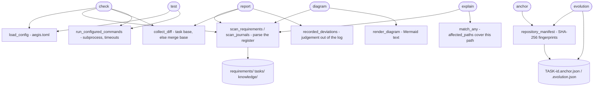

<!--
Copyright (c) 2026 DDP Engineering
This software is licensed under the PolyForm Noncommercial License 1.0.0.
Commercial use requires a separate commercial license.
See the LICENSE.txt in the .agentic folder for full license details.
SPDX-License-Identifier: LicenseRef-PolyForm-Noncommercial-1.0.0
-->

# Validation and evidence CLI

## Purpose

The canonical CLI evaluates repository governance records, runs
repository-configured validation commands, and writes reproducible task
evidence. It is advisory by default and does not enforce a workflow stage,
commit, publish, or access the network.

## Public interface

`check` reports governance findings and optionally runs configured commands.
`test` executes a named configured command, optionally recording task evidence.
`report` appends a delivery snapshot. `anchor` fingerprints repository state
for an active task, while `evolution` classifies later changes against it.
`diagram` renders the requirement register as a Mermaid coverage map, to
standard output or to a UTF-8 file. `explain` reports what governs one
repository path and which journals delivered it.

## Key behaviors

- `REQ-FUNC-871f7c12` - Evaluate governance records and diff findings.
- `REQ-FUNC-c2a3f774` - Run configured validation commands with explicit
  results.
- `REQ-FUNC-d37ad85a` - Append delivery reporting based on recorded task
  state.
- `REQ-DATA-4304dec0` - Record task-scoped repository evidence anchors.
- `REQ-DATA-7faf94ff` - Compare repository changes with an evidence anchor.
- `REQ-FUNC-6b4ff1ad` - Render the requirement register as a component
  coverage diagram.
- `REQ-FUNC-e46f1d0c` - Narrow that diagram to one component or one task.
- `REQ-FUNC-0f4eb4c5` - Trace a repository path back to the requirements and
  tasks that govern it.
- `REQ-UX-48bb759b` - Lead the delivery report with the deviations the task
  recorded.

## Architecture

Seven commands over one register. Each entry point composes shared readers
rather than owning its own parsing, which is why a finding, a report and a
diagram can never disagree about what the records say.

`explain` runs the register the other way round - a path in, the
requirements covering it out - which is why it needs no reader of its own.
Not shown: the check catalog's individual rules, and the fact that only
`anchor` and `evolution` write outside the journal. Every command here is
advisory - none of them blocks, and none of them commits.

## Files

- `05_Software/aegis/template/.agentic/aegis.py` - Canonical check, command,
  report, anchor, evolution, and diagram implementation.
- `05_Software/aegis/tests/test_check.py` - Governance-check catalog tests.
- `05_Software/aegis/tests/test_run_report.py` - Strict-mode, configured-run,
  test, and reporting tests.
- `05_Software/aegis/tests/test_repo_evolution.py` - Anchor and evolution
  evidence tests.
