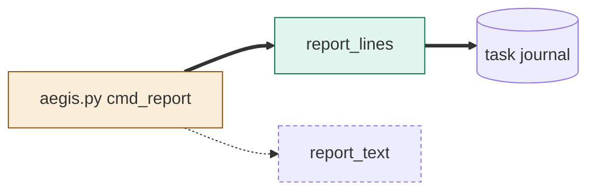

<!--
Copyright (c) 2026 DDP Engineering
This software is licensed under the PolyForm Noncommercial License 1.0.0.
Commercial use requires a separate commercial license.
See the LICENSE.txt in the .agentic folder for full license details.
SPDX-License-Identifier: LicenseRef-PolyForm-Noncommercial-1.0.0
-->

# REQ-FUNC-ee1d2096 — Draw proposed-implementation diagrams at design when enabled

## Behavior

Diagram generation is on only when `.agentic/aegis.toml` contains
`[diagrams]` with `enabled = true` as a TOML boolean. When it is on, a task
that writes a design note ends the design stage by drawing the proposed
implementation for the human operator:

1. After the design audit, the agent reads the diagram guide
   (`.agentic/steps/diagrams.md`). The design step points to the guide in one
   line, so an agent with diagrams off reads nothing more.
2. From the final `## Design` text and the source it already read, the agent
   writes one diagram for each configured type that the design covers.
3. It writes all diagrams to one file, `.agentic/tasks/diagram_TASK-<id>.md`,
   replacing any earlier version of that file.
4. It adds one link line to the journal's `## Design` section, unless the line
   is already there.

The Design text is authoritative and the diagram illustrates it. When the two
disagree, the Design text holds.

A type that does not apply to the design is skipped: the file keeps that
type's heading with one line naming the reason. When no configured type applies, the
file holds only those lines.

No file is written when the task has no design note: on the quick path, or
when design records that it is skipped.

## Data / interface

Configuration:

```toml
[diagrams]
enabled = false            # true turns on design-stage diagrams
types = ["structure"]      # any of "structure", "sequence", "state"
```

- `enabled` missing, `false`, or not a boolean: diagrams are off.
- `types` missing or not a list: `["structure"]`. `types = []`: nothing is
  drawn, and no file or link is written. Unknown names are ignored by the
  agent and reported by `check`; a list with no known name counts as an empty
  list.

Diagram types:

| Type | Mermaid header | Drawn when the design | Shows |
|---|---|---|---|
| `structure` | `flowchart LR` or `flowchart TD` | changes or adds components, modules, files, or how they connect | the parts the change touches and their calls or data flow |
| `sequence` | `sequenceDiagram` | has an execution flow across three or more participants, a process boundary, or asynchronous work | the order of calls and responses on the primary path |
| `state` | `stateDiagram-v2` | adds or changes a lifecycle, a status field, or state transitions | states and the transitions between them |

File format (`.agentic/tasks/diagram_TASK-<id>.md`):

````markdown
# TASK-<id> diagrams

Illustrates `## Design` in `TASK-<id>.md`. The Design text is authoritative.

## Structure



## Sequence

Not drawn: the change runs in one process with no asynchronous work.
````

Design link line: `Diagrams: [diagram_TASK-<id>.md](diagram_TASK-<id>.md)`.

Drawing guidance (for the agent; nothing checks it):

- Name nodes and participants after searchable code names. Give each node a
  simple id (letters, digits and underscores) and put its label in double
  quotes.
- In structure diagrams, mark nodes with `:::added`, `:::changed` or
  `:::removed`, using the three fixed `classDef` lines above. Draw added edges
  as `==>`, removed edges as `-.->` and unchanged edges as `-->`.
- Use at most about 15 nodes per diagram. Split a larger change into one
  structure diagram per component.
- Use one diagram type per fenced block, and only the headers in the table
  above.

Presentation: in checkpoint mode the design presentation shows the file's
diagrams after the stage summary and before the design stage-boundary
choices (REQ-UX-b0bd0225). In autopilot the file is written and only its
path is reported.

## Examples

- `enabled = true`, `types = ["structure", "sequence"]`. The design adds a CLI
  option that runs a plugin subprocess. The file holds a structure diagram
  marking the new option handler as `:::added` and the dispatcher as
  `:::changed`, plus a sequence diagram of CLI -> plugin -> SQLite, and
  `## Design` gains the link line.
- `enabled = true`, `types = ["state"]`. The design changes a text formatter
  only, so the file holds one line saying the state diagram is not drawn
  because no lifecycle changes.
- `enabled = "true"` (a string). Diagrams are off, and `check` warns that
  `[diagrams] enabled` should be a boolean (REQ-FUNC-cd29e673).
- Quick-path task with `enabled = true`: no design note and no file.

## Acceptance

- The design step points to the guide only for `[diagrams] enabled = true`.
- The guide names the file path, the link line, the three types with their
  applicability rule, Mermaid text as the format, the skip line, and the
  precedence of the Design text.
- `status` and `check` never read `diagram_TASK-<id>.md` as a task journal.
- No Done when item, validation step, review instruction or `check` rule
  depends on the file (REQ-FUNC-6343dfb8).

## Assumptions and open decisions

- Hosts render Mermaid differently, and a terminal shows the source. No
  behavior depends on rendering.
- Colours in the `classDef` lines are illustrative and carry no meaning that
  is checked.
