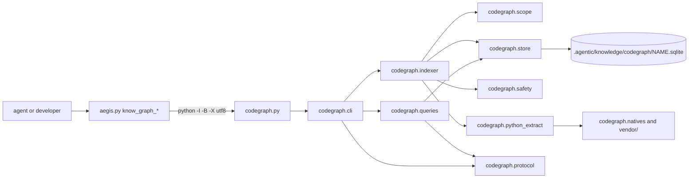

<!--
Copyright (c) 2026 DDP Engineering
This software is licensed under the PolyForm Noncommercial License 1.0.0.
Commercial use requires a separate commercial license.
See the LICENSE.txt in the .agentic folder for full license details.
SPDX-License-Identifier: LicenseRef-PolyForm-Noncommercial-1.0.0
-->

# TASK-b96d5bb3 - Add the CodeGraph code-navigation plugin and AEGIS graph commands

stage: done
type: feature
path: full
interaction: checkpoint
requirements: REQ-FUNC-b303507f, REQ-FUNC-f5d5ee3d, REQ-FUNC-8b15c62d, REQ-FUNC-b383069e, REQ-SEC-c7e64a0e, REQ-REL-53d13fb2, REQ-REL-0e1c6d89, REQ-FUNC-e780b270, REQ-FUNC-d1994267, REQ-FUNC-48ff6d8e, REQ-UX-8c5b157a, REQ-FUNC-29d6c038, REQ-FUNC-baa92928, REQ-FUNC-43a76b41, REQ-FUNC-3a18929b, REQ-FUNC-c7ece57c, REQ-FUNC-0c82c3c6, REQ-FUNC-aa0a867a, REQ-FUNC-7432a8a2, REQ-FUNC-45ed74a5, REQ-REL-1162622e, REQ-DATA-9004cf27, REQ-FUNC-e8436251, REQ-FUNC-7e74dacf, REQ-REL-1eeb1914, REQ-SEC-57e210bb, REQ-SEC-135c0df0, REQ-REL-6f924213, REQ-REL-b96977c7, REQ-REL-4277bfc7, REQ-REL-bd1529a5, REQ-REL-0858819d, REQ-REL-10dc6424, REQ-SEC-db558433, REQ-SEC-68f1bb5d, REQ-FUNC-af6434a9, REQ-FUNC-8cb1a3b7, REQ-FUNC-569a1a97, REQ-UX-461978be, REQ-FUNC-a8ece064, REQ-FUNC-41815b22, REQ-FUNC-ab604fdb, REQ-FUNC-a603d692, REQ-FUNC-d6ef4d32, REQ-FUNC-359c2a92, REQ-FUNC-81588d5e, REQ-FUNC-ff30861f, REQ-NFR-17c50caa, REQ-FUNC-ff8000c4, REQ-PLAT-dc7bdd06, REQ-PLAT-3430c1f3, REQ-FUNC-871f7c12, REQ-UX-62a24243, REQ-PLAT-e675406e
parent:
branch: ddp/codegraph-plugin-plan
base: c51c0df15fe6646369435f5852874383099fc8cc
opened: 2026-10-03

## Done checklist (current stage)

- [x] validated candidate confirmed unchanged; otherwise returned to validate
- [x] validation evidence, diff, exclusions, and outcome presented
- [x] delivery confirmed by the human
- [x] journal and report included in the delivery commit
- [x] agreed outcome delivered, normally a PR
- [x] close-out committed after the outcome succeeded, or carried by the
      delivery commit where nothing could fail after it

## Frame

Problem: Agents following AEGIS find code through repeated text searches and
whole-file reads; nothing gives them a bounded, source-cited view of
definitions and relationships. (STATED: plan
`00_Planning/06_CodeGraph_Plugin_Implementation_Plan.md`, commit c51c0df.)

Desired outcome: An optional CodeGraph plugin, run by AEGIS's own Python from a
committed `.agentic/plugins/codegraph/` folder, indexes configured source into
a checkout-local SQLite database and answers bounded, source-cited, read-only
navigation queries through flat `know_graph_*` AEGIS commands, with indexing
only on explicit request. (STATED: plan sections 1, 3, 7.)

Actors: coordinating coding agent (AEGIS CLI or host tools); read-only
reviewer agents; a developer at a terminal; the AEGIS core dispatcher; the
CodeGraph plugin process.

Primary scenario: agent runs `python .agentic/aegis.py know_graph_find
OrderRepository` -> AEGIS validates `[codegraph]` and launches
`python -I -B -X utf8 .agentic/plugins/codegraph/codegraph.py` -> the plugin
reads the index read-only -> a bounded result with symbol IDs, source ranges
and freshness labels; the agent then reads the cited source.

Examples:
- `know_graph_find` on a class in CodeGraph's own source returns its ID and
  `path:start-end`.
- `know_graph_callers <id>` labels name-matched callers `candidate`, never
  confirmed.
- `know_graph` in a repository without `[codegraph]` returns `status: disabled`
  without starting a process.

Counterexamples:
- A query never creates, refreshes or repairs the database.
- An empty result is `status: ok` with no results, not "no usages anywhere".
- Indexing never writes outside `.agentic/knowledge/codegraph/`.
- A name match never becomes a confirmed caller or a test-coverage edge.

In scope (accepted, RULING-002; this task = the plan's first usable milestone):
- Vendored-parser feasibility and the tested support matrix.
- Configuration, layout matching, metadata discovery, read-only scope preview.
- Protocol specification, fixtures and stub provider.
- SQLite storage and Python extraction (CodeGraph's own source as first
  fixture, AEGIS's source as secondary pilot).
- Incremental publication, write preconditions, writer lock, recovery, stdin
  liveness, freshness check.
- Read-only query API (status, check, find, file, symbol, callers, refs).
- AEGIS core dispatcher with the seven read commands plus `know_graph_index`;
  `CLI.md` and `AGENTS.md` updates.
- This repository's `[layout]`/`[commands]`, a dogfood install with its ignore
  rule, changelog entry, component knowledge page.

Out of scope (accepted for later tasks on this branch):
- C# and TypeScript/JavaScript extraction.
- `codegraph install`/`uninstall` (the dogfood ignore rule is added by hand).
- Host adapter integration and maintenance jobs.
- Release builder and distribution archives; version assignment and releases
  (repository operations).
- CI infrastructure (no CI system exists in this repository).
- Navigation benchmarks.

Constraints:
- `aegis.py` stays one standard-library file; about 300 added lines is a review
  target. (STATED: plan section 11.)
- The plugin runs on AEGIS's Python 3.11+ with `-I -B -X utf8`; recipients
  install nothing. (STATED: plan sections 1, 3.)
- Disabled or absent CodeGraph leaves every existing command unchanged.
  (STATED: plan section 9.)
- Offline-first: an online dependency needs explicit approval. (OBSERVED:
  `AGENTS.md` repository rules.)
- Durable names describe behavior, never plan item numbers. (OBSERVED:
  `AGENTS.md` style rules.)
- Explicit review is enabled; checkpoint mode is the default. (OBSERVED:
  `.agentic/aegis.toml` `[review]`, `[interaction]`.)

Success signals:
- On Windows (Python 3.11, 3.12, 3.14) and WSL Ubuntu 24.04, `know_graph_index`
  followed by `know_graph_find`/`symbol`/`callers` over CodeGraph's own source
  returns correct cited definitions.
- Read-only boundary tests show no filesystem change from status, check or
  queries, including no bytecode.
- The existing product suite passes unchanged and a disabled project shows no
  behavior change.
- `check --task TASK-b96d5bb3 --strict --run` passes with the plugin suite
  configured.
- Both independent reviews approve.

Evidence:
- STATED: user request in this session ("using aegis workflow, on the same
  branch, implement the plan"); plan decisions in commit c51c0df.
- OBSERVED: core is a single 4,133-line standard-library file
  (`05_Software/aegis/template/.agentic/aegis.py`); `kill_tree` uses
  `os.killpg` and `run_command` sets `start_new_session`
  (`aegis.py` lines 2740, 2783); an unknown command exits 2 (run on 0.13.0);
  every parser command needs a `CLI.md` section
  (`05_Software/aegis/tests/test_structure.py:139`); every `CONFIG_SHAPE` key
  must appear in the default config (`test_cli_core.py:322`); this
  repository's layout omits plugin paths (`.agentic/aegis.toml`); the core
  payload inventory is fixed at 17 files (`02_Tools/build_aegis_release.py`).
- OBSERVED toolchain: Python 3.11, 3.12 and 3.14 (`py -0p`); pytest 9.1.1;
  Ruff 0.16.1; Node 24.18; SQLite 3.49.1 with FTS5 under Python 3.12;
  `tree_sitter` not installed; WSL Ubuntu-24.04 present; Docker absent.
- INFERRED: the first milestone is useful on its own through the direct CLI,
  and host adapters can follow without changing the protocol.
- UNKNOWN: whether the pinned Tree-sitter packages ship abi3 wheels, and
  their sizes; the cancellation API of the pinned binding; the Python version
  inside WSL Ubuntu; real indexing and query performance.

Assumptions:
- WSL2 Ubuntu 24.04 serves as the Ubuntu test environment.
- The initial support matrix covers only interpreters available here.
- This repository's ignore rule for `.agentic/knowledge/codegraph/` is added
  by hand until the installer exists.

Unknowns: see Evidence UNKNOWN.

Decision-blocking questions:
1. Scope: this task covers the first milestone (recommended), or the whole
   plan in one task, or a parent task with one child per deliverable group?
2. Online dependency: may the build download pinned Tree-sitter wheels from
   PyPI, and may their native binaries (target <=30 MiB) be committed? Exact
   files and sizes are confirmed before any download.
3. Is WSL2 Ubuntu 24.04 acceptable as the Ubuntu test environment?
Resolved 2026-10-03 by the user: first milestone only (RULING-002); PyPI
wheel download and committed natives approved (RULING-003); WSL2 Ubuntu
24.04 accepted (RULING-004).

Proposed behaviors:
- B1 `know_graph_*` commands dispatch to the fixed plugin entry point with
  bounded output and time; disabled projects start nothing.
- B2 scope discovery reuses `[layout]` matching, reports Git or filesystem
  inventory, and previews without writing.
- B3 indexing extracts Python definitions, references and candidate links with
  exact ranges and resolution labels.
- B4 indexing honors write preconditions, the writer lock, recovery and parent
  liveness, and publishes atomically.
- B5 queries are read-only and return the protocol's separate status, index,
  freshness and capability fields.
- B6 `know_graph_check` compares sources with the recorded manifest without
  writing.
- B7 natives load only for indexing; an unmatched Python can still query.
Each maps to the desired outcome and at least one success signal.

Path and reason: full path.
- no new externally observable behavior | no | new `know_graph_*` commands
- no new interface or data format | no | new protocol, config table, database
- no new dependency | no | vendored Tree-sitter natives
- an existing requirement covers the behavior | no | no CodeGraph requirement
  in `.agentic/requirements/`
- no security or data-handling change | no | new subprocess and file writes
Children: not proposed inside this milestone; engine and core dispatch are
coupled through one protocol. Later milestones become separate tasks.

## Requirement coverage

Frame outcomes B1-B7 are the Frame's proposed behaviors. Exact contracts live in four draft specs: dispatch (specs/REQ-FUNC-b383069e.md), protocol (specs/REQ-FUNC-8cb1a3b7.md), Python extraction (specs/REQ-FUNC-aa0a867a.md) and write safety (specs/REQ-REL-1eeb1914.md).

Challenge and audit: no semantic conflict with existing requirements; REQ-FUNC-8ec7a0c7 (component pages) is unaffected because it reads only top-level knowledge pages. `find` filters are deferred. Open assumptions to confirm in build are recorded in the specs: Tree-sitter cancellation in the pinned binding, abi3 availability, `SQLITE_READONLY_ROLLBACK` for hot journals, and `git check-ignore` on not-yet-existing files. `check` reports `stale-paths` for affected paths that build will create.

| Frame outcome | Atomic behavior | Requirement | Positive case | Boundary or failure | Verification | Design decision and test seam |
|---|---|---|---|---|---|---|
| B1 | Report disabled CodeGraph without starting the plugin | REQ-FUNC-b303507f | disabled report, no process | enabled=true launches | stub launch log | D5; `05_Software/aegis/tests/test_codegraph_dispatch.py` |
| B1 | Report a missing plugin as unavailable | REQ-FUNC-f5d5ee3d | plugin_missing, exit 0 | stub present launches | isolated copy | D5; `05_Software/aegis/tests/test_codegraph_dispatch.py` |
| B1 | Start the CodeGraph plugin only from knowledge-graph commands | REQ-FUNC-8b15c62d | only know_graph starts plugin | ten governance commands start nothing | stub launch log | D1, D4; `05_Software/aegis/tests/test_codegraph_dispatch.py` |
| B1 | Dispatch knowledge-graph queries to the plugin | REQ-FUNC-b383069e | operation, paths, flags, target | dash-leading target; missing target exit 2 | stub argv record | D1, D4; `05_Software/aegis/tests/test_codegraph_dispatch.py` |
| B1 | Confine the configured database path before dispatch | REQ-SEC-c7e64a0e | valid NAME.sqlite launches | outside, nested, sidecar, lock, symlink rejected | isolated copies | D1, D4; `05_Software/aegis/tests/test_codegraph_dispatch.py` |
| B1 | Stop a plugin that exceeds its time limit | REQ-REL-53d13fb2 | tree killed, exit 1 | index limit 0 means none | slow stub with child | D1, D4; `05_Software/aegis/tests/test_codegraph_dispatch.py` |
| B1 | Bound the plugin output while it is read | REQ-REL-0e1c6d89 | stops at cap, exit 1 | just-under-cap succeeds | 10 MiB stub | D1, D4; `05_Software/aegis/tests/test_codegraph_dispatch.py` |
| B1 | Validate the plugin protocol before printing a response | REQ-FUNC-e780b270 | valid envelope printed | six malformed outputs fail | malformed stubs | D1, D4; `05_Software/aegis/tests/test_codegraph_dispatch.py` |
| B1 | Map the plugin response status to the exit code | REQ-FUNC-d1994267 | status to exit mapping | error exits 1 | stub per status | D1, D4; `05_Software/aegis/tests/test_codegraph_dispatch.py` |
| B1 | Run explicit indexing with parent liveness | REQ-FUNC-48ff6d8e | index with liveness pipe and progress | AEGIS killed closes pipe | stub index | D1, D4; `05_Software/aegis/tests/test_codegraph_dispatch.py` |
| B1 | Describe the knowledge-graph capability in the workflow contract | REQ-UX-8c5b157a | contract describes use, folders, limits | no overclaim of proof | Inspection | docs (AGENTS.md, CLI.md); Inspection |
| B2 | Preview the indexing scope without writing | REQ-FUNC-29d6c038 | totals, counts, skips reported | no file or bytecode written | tree snapshot | D3 scope; `05_Software/aegis/plugins/codegraph/tests/test_scope.py` |
| B2 | Select source files with the AEGIS layout rules | REQ-FUNC-baa92928 | AEGIS matching semantics | exclude wins; root .agentic excluded | shared matcher fixtures | D3 scope; `05_Software/aegis/plugins/codegraph/tests/test_scope.py` |
| B2 | Report a missing scope instead of scanning the repository | REQ-FUNC-43a76b41 | scope_missing, nothing indexed | include alone suffices | empty layout fixture | D3 scope; `05_Software/aegis/plugins/codegraph/tests/test_scope.py` |
| B2 | Inventory files from Git or the filesystem | REQ-FUNC-3a18929b | Git or filesystem inventory | Git listing failure is error | three inventory fixtures | D3 scope; `05_Software/aegis/plugins/codegraph/tests/test_scope.py` |
| B2 | Discover project manifests outside the selected sources | REQ-FUNC-c7ece57c | ancestor manifests hashed | excluded manifests ignored; no symbols | nested pyproject fixture | D3 scope; `05_Software/aegis/plugins/codegraph/tests/test_scope.py` |
| B3 | Derive Python module names from import roots | REQ-FUNC-0c82c3c6 | roots from setting, manifests, src | setup.py never executed | marker-file fixture | D3 python_extract; `05_Software/aegis/plugins/codegraph/tests/test_python_extract.py` |
| B3 | Extract Python definitions with exact source ranges | REQ-FUNC-aa0a867a | kinds, names, signatures, positions | comments and strings yield none; CRLF, non-ASCII | golden fixtures | D3 python_extract; `05_Software/aegis/plugins/codegraph/tests/test_python_extract.py` |
| B3 | Label Python references by their resolution evidence | REQ-FUNC-7432a8a2 | labels by evidence | name-only stays candidate; no coverage edge | label fixtures | D3 python_extract; `05_Software/aegis/plugins/codegraph/tests/test_python_extract.py` |
| B3 | Keep only safe facts from files with syntax errors | REQ-FUNC-45ed74a5 | partial keeps safe facts | undecodable file failed; old facts removed | broken-file fixtures | D3 python_extract; `05_Software/aegis/plugins/codegraph/tests/test_python_extract.py` |
| B3 | Bound parsing time per file | REQ-REL-1162622e | slow file failed parse-timeout | later files still parse | slowed-parse hook | D9; `05_Software/aegis/plugins/codegraph/tests/test_python_extract.py` |
| B3 | Identify symbols with stable 128-bit IDs | REQ-DATA-9004cf27 | stable 128-bit IDs | rename changes ID; duplicates distinct | re-index comparison | D6; `05_Software/aegis/plugins/codegraph/tests/test_python_extract.py` |
| B5 | Resolve symbol ID prefixes without guessing | REQ-FUNC-e8436251 | unique prefix resolves | ambiguous lists choices; unknown not_found | seeded index | D3 queries; `05_Software/aegis/plugins/codegraph/tests/test_queries.py` |
| B4 | Update the index incrementally | REQ-FUNC-7e74dacf | unchanged files reused | delete, rename, exclude, manifest change | parse counter | D7; `05_Software/aegis/plugins/codegraph/tests/test_indexer.py` |
| B4 | Publish each index generation atomically | REQ-REL-1eeb1914 | one generation per run | killed run keeps previous snapshot | injected kills | D3 safety and store, D6; `05_Software/aegis/plugins/codegraph/tests/test_write_safety.py` |
| B4 | Refuse to index into storage that Git would record | REQ-SEC-57e210bb | ignored, untracked folder proceeds | not ignored or tracked refuses before any write | Git fixtures | D3 safety and store, D6; `05_Software/aegis/plugins/codegraph/tests/test_write_safety.py` |
| B4 | Open only CodeGraph databases for writing | REQ-SEC-135c0df0 | CodeGraph database opened | foreign file left byte-identical | foreign-file fixtures | D3 safety and store, D6; `05_Software/aegis/plugins/codegraph/tests/test_write_safety.py` |
| B4 | Allow one index writer at a time | REQ-REL-6f924213 | second writer busy | killed holder releases lock | concurrent runs | D3 safety and store, D6; `05_Software/aegis/plugins/codegraph/tests/test_write_safety.py` |
| B5 | Classify database state through SQLite for readers | REQ-REL-b96977c7 | states from SQLite errors | harmless journal and RESERVED lock keep reads working | journal fixtures | D3 safety and store, D6; `05_Software/aegis/plugins/codegraph/tests/test_write_safety.py` |
| B4 | Recover an interrupted write only during explicit indexing | REQ-REL-4277bfc7 | index rolls back hot journal | readers never repair | interrupted write | D3 safety and store, D6; `05_Software/aegis/plugins/codegraph/tests/test_write_safety.py` |
| B4 | Rebuild without replacing the wrong file | REQ-REL-bd1529a5 | validated temp replaces target | damaged old file and journal replaced together; failure keeps old | rebuild fixtures | D3 safety and store, D6; `05_Software/aegis/plugins/codegraph/tests/test_write_safety.py` |
| B4 | Stop indexing when its launcher disappears | REQ-REL-0858819d | EOF cancels run | no flag means no cancel | closed pipe | D9; `05_Software/aegis/plugins/codegraph/tests/test_write_safety.py` |
| B4 | Discard an indexing run whose plugin code changed | REQ-REL-10dc6424 | changed plugin discards run | unchanged publishes | pause hook | D3 safety and store, D6; `05_Software/aegis/plugins/codegraph/tests/test_write_safety.py` |
| B4 | Write only generated storage during indexing | REQ-SEC-db558433 | writes only in storage folder | no bytecode anywhere | tree snapshot | D3 safety and store, D6; `05_Software/aegis/plugins/codegraph/tests/test_write_safety.py` |
| B4 | Confine the database path in direct plugin runs | REQ-SEC-68f1bb5d | plugin validates path | default proceeds | direct invocation | D3 config; `05_Software/aegis/plugins/codegraph/tests/test_config.py` |
| B5 | Answer queries without writing | REQ-FUNC-af6434a9 | queries change nothing | every database state; read-only folder | tree snapshot | D3 queries; `05_Software/aegis/plugins/codegraph/tests/test_queries.py` |
| B5 | Report status, index, freshness and capability separately | REQ-FUNC-8cb1a3b7 | separate status fields | empty ok versus unavailable | fixture validation | D4 protocol; `05_Software/aegis/plugins/codegraph/tests/test_protocol.py` |
| B5 | Answer in the requested protocol version | REQ-FUNC-569a1a97 | version 1 answered | other versions error protocol | version requests | D4 protocol; `05_Software/aegis/plugins/codegraph/tests/test_protocol.py` |
| B5 | Render compact text by default and JSON on request | REQ-UX-461978be | compact text and one JSON | silent stderr for queries | golden text | D4 protocol; `05_Software/aegis/plugins/codegraph/tests/test_protocol.py` |
| B5 | Report knowledge-graph status | REQ-FUNC-a8ece064 | availability and Git diagnostics | no source file read | open hook | D3 queries; `05_Software/aegis/plugins/codegraph/tests/test_queries.py` |
| B6 | Check index freshness against the sources | REQ-FUNC-41815b22 | current or stale with lists | mid-check edit gives unknown; nothing written | check fixtures | D3 queries; `05_Software/aegis/plugins/codegraph/tests/test_queries.py` |
| B5 | Find symbols by name | REQ-FUNC-ab604fdb | ranked matches | equal matches all returned | ranking fixture | D8; `05_Software/aegis/plugins/codegraph/tests/test_queries.py` |
| B5 | Outline one indexed file | REQ-FUNC-a603d692 | outline in source order | unindexed path not_found | module fixture | D3 queries; `05_Software/aegis/plugins/codegraph/tests/test_queries.py` |
| B5 | Show a symbol and its neighborhood | REQ-FUNC-d6ef4d32 | bounded one-hop neighborhood | high fan-out truncated | neighborhood fixture | D3 queries; `05_Software/aegis/plugins/codegraph/tests/test_queries.py` |
| B5 | List the callers of a symbol | REQ-FUNC-359c2a92 | linked and candidate lists | same-name call stays candidate | caller fixture | D3 queries; `05_Software/aegis/plugins/codegraph/tests/test_queries.py` |
| B5 | List the references to a symbol | REQ-FUNC-81588d5e | references with kinds | shadowing local excluded | reference fixture | D3 queries; `05_Software/aegis/plugins/codegraph/tests/test_queries.py` |
| B5 | Check cited files before reporting locations | REQ-FUNC-ff30861f | changed citations marked stale | unchanged stay current | edit after index | D3 queries; `05_Software/aegis/plugins/codegraph/tests/test_queries.py` |
| B5 | Bound query output | REQ-NFR-17c50caa | 20 records, 8 KiB | enlarged capped at 32 KiB | fan-out fixture | D4 protocol; `05_Software/aegis/plugins/codegraph/tests/test_protocol.py` |
| B5 | Page through results with request-bound tokens | REQ-FUNC-ff8000c4 | every record once | expired after rebuild; mismatch error | paging fixture | D3 queries; `05_Software/aegis/plugins/codegraph/tests/test_queries.py` |
| B7 | Use the vendored parsers that match the running Python | REQ-PLAT-dc7bdd06 | matching natives load for indexing only | no match false; newer abi3 untested; no shadowing | simulated platforms | D11; `05_Software/aegis/plugins/codegraph/tests/test_natives.py` |
| B7 | Behave identically on Windows and Ubuntu | REQ-PLAT-3430c1f3 | same results on both OSes | CRLF, non-ASCII fixtures | Windows 3.11/3.12/3.14 and WSL Ubuntu | D11; plugin suites on Windows 3.11, 3.12, 3.14 and WSL Ubuntu 24.04 |
| B1 | `check` reports malformed core-validated `[codegraph]` keys | REQ-FUNC-871f7c12 (reused) | wrong type warns | absent table is silent | check config tests | D1, D4; `05_Software/aegis/tests/test_codegraph_dispatch.py` |
| B1 | `CLI.md` documents the eight commands | REQ-UX-62a24243 (reused) | one section per command | existing sections unchanged | structure test and inspection | docs; `05_Software/aegis/tests/test_structure.py` CLI-section guard and Inspection |
| constraint | `aegis.py` stays standard-library only | REQ-PLAT-e675406e (reused) | no new import | no plugin code imported | payload structure tests | D1; `05_Software/aegis/tests/test_structure.py` |

## Design

Exact contracts stay in the four specs; this note fixes the implementation
shape. Decisions cite the forcing requirement or a named constraint.

**Requirements coverage.** Every requirement maps to a decision below and a
test seam in the coverage table. REQ-UX-8c5b157a is documentation only;
REQ-PLAT-e675406e is a constraint with no design impact beyond D1.

**Component responsibilities.**
- D1 AEGIS core (`template/.agentic/aegis.py`) owns `[codegraph]` core keys,
  database-path validation, the eight `know_graph*` subcommands and one
  bounded dispatcher. It imports nothing new and never imports plugin code
  (REQ-PLAT-e675406e, REQ-FUNC-8b15c62d, REQ-FUNC-b383069e).
- D2 CodeGraph plugin (`05_Software/aegis/plugins/codegraph/`) owns scope,
  extraction, storage, write safety, queries and rendering. The entry
  `codegraph.py` sets `sys.dont_write_bytecode`, puts its own folder first on
  `sys.path` and calls `codegraph.cli.main`. The package folder `codegraph/`
  is imported in preference to the same-named entry file because the Python
  path finder resolves a package folder before a module file (technical
  constraint).
- D3 Plugin modules: `config` (TOML, defaults, validation, database rule),
  `scope` (matcher, inventory, selection, manifests, scope report),
  `natives` (vendor selection, capability, lazy import), `python_extract`
  (Tree-sitter facts and in-file bindings), `store` (schema, read-only and
  read-write opening, header ownership, SQLite state mapping), `safety` (Git
  precondition, writer lock, plugin identity, rebuild replacement),
  `indexer` (orchestration, cancellation, cross-file resolution,
  publication), `queries` (status, check, find, file, symbol, callers, refs,
  prefixes, paging, cited files), `protocol` (envelope, budgets, text,
  tokens), `cli` (arguments, views, exit codes).

**Interfaces and contracts.**
- D4 The core-to-plugin interface follows the dispatch spec. AEGIS always asks
  for a JSON envelope (`--json` or `--text-envelope`), so it can validate every
  response and still print a single rendering (REQ-FUNC-e780b270,
  REQ-UX-461978be). Rejected: rendering text in the core, which would grow
  `aegis.py` with presentation code.
- D5 Core-produced responses (`disabled`, `plugin_missing`) use the same
  envelope with a fixed one-line text (REQ-FUNC-b303507f, REQ-FUNC-f5d5ee3d).

**Data ownership and state.**
- D6 SQLite schema version 1 (`user_version` 1, `application_id`
  0x43474731): `meta` (snapshot, generation, indexed_at, config_digest,
  extractor revisions, plugin_version), `files` (path, role, language,
  sha256, size, status, reason, extractor), `manifests` (path, sha256),
  `symbols` (id, file, parent id, kind, name, qualified_name, signature,
  positions, depth, words), `refs` (file, from id, kind, spelling, position,
  binding, local target, qualified target, label, target id), `candidates`
  (ref, symbol, rank). Indexes on names, qualified names, file, target and
  candidate symbol. No separate edges table: `refs.target_id` and
  `candidates` carry the relations (REQ-FUNC-7432a8a2, REQ-DATA-9004cf27).
- D7 Extraction stores how each reference was bound (`local`, `import`,
  `builtin`, `dynamic`, `star`, `unbound`); the indexer recomputes labels,
  targets and candidates for all references on every publication, so
  unchanged files are reused without stale cross-file links
  (REQ-FUNC-7e74dacf, extraction spec).
- D8 `find` scans `symbols` with a precomputed lower-case `words` column; FTS5
  is detected and recorded but unused in this milestone (REQ-FUNC-ab604fdb;
  FTS5 availability varies with the user's Python).

**Execution flow.** `index`: config, Git precondition, lock, ownership,
plugin identity, inventory and hashes, sequential extraction of changed files
outside any transaction, then one `BEGIN IMMEDIATE` publication with
re-resolution and the identity re-check (write-safety spec). Queries: config,
read-only open, state mapping, query, cited-file hashing, budgeted rendering.

**Failure recovery, concurrency and cancellation.** As in the write-safety
spec. D9 Extraction runs sequentially in the indexing process using
Tree-sitter's own cancellation; a worker pool (spawn method) is added only if
the feasibility check shows cancellation cannot bound a parse
(REQ-REL-1162622e, REQ-REL-0858819d). Without workers, the worker clauses of
REQ-REL-6f924213 and REQ-REL-0858819d have nothing to act on.

**Security and trust.** D10 The core runs only `sys.executable` with the fixed
entry point, the flags `-I -B -X utf8` and an argument array; targets follow
`--` (REQ-FUNC-b383069e). The database path is confined in both processes
(REQ-SEC-c7e64a0e, REQ-SEC-68f1bb5d). Indexing writes only the storage
folder, after the Git precondition and the ownership check
(REQ-SEC-57e210bb, REQ-SEC-135c0df0, REQ-SEC-db558433).

**Dependency and vendoring.** D11 The pinned Tree-sitter binding and Python
grammar wheels are recorded with hashes in `requirements.lock`; their packages
are unpacked under `vendor/<platform>-<abi>/` and described in
`MANIFEST.json` (tags, minimum Python, tested matrix, plugin and protocol
versions). Feasibility first lists the exact wheel files, source and sizes for
user confirmation before any download (RULING-003). Vendoring in this
milestone is a documented developer procedure in the plugin README; the
release builder is deferred (RULING-002). Natives are committed in canonical
source and in this repository's dogfood install; Git stores identical content
once. A plugin-local `ruff.toml` excludes vendored third-party code from lint
(technical constraint: `[commands] lint` covers `05_Software/aegis`).

**Compatibility and migration.** Disabled is the default; existing commands,
outputs and exit codes are unchanged (REQ-FUNC-b303507f, REQ-FUNC-8b15c62d).
Top-level help gains eight commands. The template and the installed
`.agentic/` mirror stay identical (existing mirror tests). No version bump
(repository operation).

**Observability.** `scope` previews selection; `status` reports state,
coverage and Git diagnostics; `index` writes per-phase progress and counts to
standard error; failures carry `reason` and a one-line message.

**Test seams.**
- Core: `05_Software/aegis/tests/test_codegraph_dispatch.py`, using an
  isolated payload copy and a stub plugin that records interpreter flags,
  arguments and launches and prints a configured envelope.
- Plugin: `05_Software/aegis/plugins/codegraph/tests/` with `test_config.py`,
  `test_scope.py`, `test_python_extract.py`, `test_indexer.py`,
  `test_write_safety.py`, `test_queries.py`, `test_protocol.py`,
  `test_natives.py` and `test_cli.py`; fixtures and golden outputs in
  `tests/fixtures/`. Test hooks (slow parse, pause before publication, kill
  points) are environment-variable switches read only by the indexer.
- Parity: the same suites run on Windows Python 3.11, 3.12 and 3.14 and on
  WSL Ubuntu 24.04 (RULING-004).

**Repository configuration.** `[layout]` gains `05_Software/aegis/plugins/`
and the plugin tests folder; `[commands]` gains `codegraph_test`; the dogfood
install mirrors the plugin into `.agentic/plugins/codegraph/` with
`[codegraph] enabled = true` and `.agentic/knowledge/codegraph/` in
`.gitignore`. Docs: `CLI.md` (eight sections), `AGENTS.md` (navigation and
ownership), `05_Software/aegis/README.md`,
`06_SoftwareDocu/09_CLI_Reference.md`, the plugin README and the
`CHANGELOG.md` Unreleased section; the component page is written in validate.

### Proposed architecture - TASK-b96d5bb3

**Expected files.** Core: `05_Software/aegis/template/.agentic/aegis.py`,
`CLI.md` and `AGENTS.md`, with their `.agentic/` mirrors;
`05_Software/aegis/tests/test_codegraph_dispatch.py`. Plugin: `codegraph.py`;
`codegraph/__init__.py`, `config.py`, `scope.py`, `natives.py`,
`python_extract.py`, `store.py`, `safety.py`, `indexer.py`, `queries.py`,
`protocol.py`, `cli.py`; `MANIFEST.json`, `NOTICES.txt`, `requirements.lock`,
`README.md`, `ruff.toml`, `vendor/`, `tests/`. Repository:
`.agentic/aegis.toml`, `.gitignore`, `.agentic/plugins/codegraph/`,
`CHANGELOG.md`, `05_Software/aegis/README.md`,
`06_SoftwareDocu/09_CLI_Reference.md`.

**Risks.**
- No abi3 wheels, or none for Python 3.14: more native sets, or 3.14 reports
  `indexing_supported` false (REQ-PLAT-dc7bdd06).
- The py-tree-sitter API differs between versions; the pinned version fixes it.
- The hot-journal error code and `git check-ignore` behavior are unconfirmed;
  both are tested first, with the fallbacks recorded in the specs.
- WSL may lack pytest or `venv`; a wheel-based `PYTHONPATH` setup avoids
  system changes.
- Size: the milestone is several thousand lines; build proceeds module by
  module, test-first.

**Open decisions.** The worker pool is added only if feasibility requires it
(D9). No open product decisions.

## Log

- 2026-10-03 frame: full path (new commands, protocol, dependency); proposed scope is the plan's first usable milestone, other deliverables deferred to later tasks; scope paused for user confirmation with three decision-blocking questions.
- 2026-10-03 frame: user accepted the first-milestone scope and answered all three questions (RULING-002 to RULING-004); advanced to specify.
- 2026-10-03 specify: 51 requirements created (all draft), 0 revised, 3 reused (REQ-FUNC-871f7c12, REQ-UX-62a24243, REQ-PLAT-e675406e), 0 retired; four specs written; `check` shows no format errors; paused for the specify checkpoint.
- 2026-10-03 specify: user chose to continue; advanced to design.
- 2026-10-03 design: design note D1-D11 with proposed architecture written in ## Design; coverage table names a decision and test seam for every requirement; paused for the design checkpoint.
- 2026-10-03 design: user chose to continue; advanced to build.
- 2026-10-03 build feasibility: 10 user-approved wheels downloaded from PyPI and SHA-256-verified (tree-sitter 0.26.0 per-version cp311-cp314 for win_amd64 and manylinux x86_64; tree-sitter-python 0.25.0 abi3; 3,374,271 bytes). Their pure-Python files are identical, so one vendor folder holds every binary and Python's extension suffixes select the matching one; loading under -I -B works on Windows 3.11, 3.12, 3.14 and WSL 3.12 without writing bytecode.
- 2026-10-03 build feasibility: Parser.parse with any progress_callback crashes the interpreter on Python 3.11 and 3.12 (Windows access violation, WSL SIGSEGV) and works on 3.14; plain parsing works everywhere. Design D9 fallback applies (RULING-005). SQLITE_READONLY_ROLLBACK for a hot journal and git check-ignore on not-yet-existing files confirmed on Windows and WSL; extraction and write-safety specs updated.
- 2026-10-03 build: DEVIATION build: vendored natives share one vendor/ folder selected by Python extension suffixes instead of the vendor/<platform>-<abi>/ folders of design D11 - same behavior with simpler selection; MANIFEST.json still records the tested matrix (RULING-006).
- 2026-10-03 build red: REQ-PLAT-dc7bdd06; command=`python -m pytest -q -p no:cacheprovider 05_Software/aegis/plugins/codegraph/tests/test_natives.py`; exit=2; expected missing behavior=`codegraph.natives` does not exist (ImportError at collection).
- 2026-10-03 build green: REQ-PLAT-dc7bdd06; command=`python -m pytest -q -p no:cacheprovider 05_Software/aegis/plugins/codegraph/tests/test_natives.py`; exit=0; 6 passed (Windows, Python 3.12).
- 2026-10-03 build red: REQ-SEC-68f1bb5d; command=`python -m pytest -q -p no:cacheprovider 05_Software/aegis/plugins/codegraph/tests/test_config.py`; exit=2; expected missing behavior=`codegraph.config` does not exist (ImportError at collection).
- 2026-10-03 build green: REQ-SEC-68f1bb5d (settings and path unit seam); same command; exit=0; 19 passed, 1 skipped (symlink case needs symlink rights; runs on WSL).
- 2026-10-03 build red: REQ-FUNC-baa92928, REQ-FUNC-43a76b41, REQ-FUNC-3a18929b, REQ-FUNC-c7ece57c; command=`python -m pytest -q -p no:cacheprovider 05_Software/aegis/plugins/codegraph/tests/test_scope.py`; exit=2; expected missing behavior=`codegraph.scope` does not exist (ImportError at collection).
- 2026-10-03 build green: REQ-FUNC-baa92928, REQ-FUNC-43a76b41, REQ-FUNC-3a18929b, REQ-FUNC-c7ece57c; same command; exit=0; 25 passed.
- 2026-10-03 build red: REQ-FUNC-aa0a867a, REQ-FUNC-7432a8a2, REQ-FUNC-45ed74a5, REQ-FUNC-0c82c3c6, REQ-DATA-9004cf27, REQ-REL-1162622e; command=`python -m pytest -q -p no:cacheprovider 05_Software/aegis/plugins/codegraph/tests/test_python_extract.py`; exit=2; expected missing behavior=`codegraph.python_extract` does not exist (ImportError at collection).
- 2026-10-03 build green: REQ-FUNC-aa0a867a, REQ-FUNC-7432a8a2 (in-file bindings), REQ-FUNC-45ed74a5 (extraction side), REQ-FUNC-0c82c3c6, REQ-DATA-9004cf27, REQ-REL-1162622e; same command; exit=0; 17 passed.
- 2026-10-03 build red: REQ-FUNC-8cb1a3b7, REQ-UX-461978be, REQ-NFR-17c50caa, REQ-FUNC-ff8000c4 (token format); command=`python -m pytest -q -p no:cacheprovider 05_Software/aegis/plugins/codegraph/tests/test_protocol.py`; exit=2; expected missing behavior=`codegraph.protocol` does not exist (ImportError at collection).
- 2026-10-03 build green: REQ-FUNC-8cb1a3b7, REQ-UX-461978be, REQ-NFR-17c50caa, REQ-FUNC-ff8000c4 (token format); same command; exit=0; 54 passed.
- 2026-10-03 build red: REQ-FUNC-7e74dacf, REQ-REL-1eeb1914, REQ-FUNC-7432a8a2 (cross-file labels), REQ-FUNC-45ed74a5 (fact replacement), REQ-SEC-57e210bb, REQ-SEC-135c0df0, REQ-REL-6f924213, REQ-REL-b96977c7, REQ-REL-4277bfc7, REQ-REL-bd1529a5, REQ-REL-0858819d, REQ-REL-10dc6424, REQ-SEC-db558433; command=`python -m pytest -q -p no:cacheprovider 05_Software/aegis/plugins/codegraph/tests/test_indexer.py 05_Software/aegis/plugins/codegraph/tests/test_write_safety.py`; exit=2; expected missing behavior=`codegraph.indexer`, `codegraph.store` and `codegraph.safety` do not exist (ImportError at collection).
- 2026-10-03 build discovery: on Windows a child process that inherits a stdin pipe another thread is reading blocks until that read ends, which stalled `--watch-stdin` indexing at its first Git call; internal Git calls now get `stdin=DEVNULL`. Also confirmed: a transaction killed before any page reaches the database leaves a journal SQLite does not treat as hot, so readers keep the previous generation; the test hook forces a page spill to produce a genuine hot journal. Rebuild now discards the old file's leftover journal with the old file (write-safety spec step 3 updated).
- 2026-10-03 build green: same 13 requirements; command=`python -m pytest -q -p no:cacheprovider 05_Software/aegis/plugins/codegraph/tests/test_indexer.py 05_Software/aegis/plugins/codegraph/tests/test_write_safety.py`; exit=0; 23 passed. Whole plugin suite so far: 144 passed, 1 skipped.
- 2026-10-03 build red: REQ-FUNC-af6434a9, REQ-FUNC-a8ece064, REQ-FUNC-41815b22, REQ-FUNC-ab604fdb, REQ-FUNC-a603d692, REQ-FUNC-d6ef4d32, REQ-FUNC-359c2a92, REQ-FUNC-81588d5e, REQ-FUNC-ff30861f, REQ-FUNC-e8436251, REQ-FUNC-ff8000c4, REQ-NFR-17c50caa (query output), REQ-FUNC-29d6c038, REQ-FUNC-569a1a97, REQ-UX-461978be (command line), REQ-SEC-68f1bb5d (command line); command=`python -m pytest -q -p no:cacheprovider 05_Software/aegis/plugins/codegraph/tests/test_queries.py 05_Software/aegis/plugins/codegraph/tests/test_cli.py`; exit=1; expected missing behavior=`codegraph.queries` does not exist, so every query operation fails.
- 2026-10-03 build red correction: the run above exited 2 (ImportError of `codegraph.queries` at collection), not 1.
- 2026-10-03 build green: the same 16 requirements; command=`python -m pytest -q -p no:cacheprovider 05_Software/aegis/plugins/codegraph/tests/test_queries.py 05_Software/aegis/plugins/codegraph/tests/test_cli.py`; exit=0; 24 passed, 1 skipped (read-only folder case is POSIX-only; runs on WSL).
- 2026-10-03 build red: REQ-FUNC-b303507f, REQ-FUNC-f5d5ee3d, REQ-FUNC-8b15c62d, REQ-FUNC-b383069e, REQ-SEC-c7e64a0e, REQ-REL-53d13fb2, REQ-REL-0e1c6d89, REQ-FUNC-e780b270, REQ-FUNC-d1994267, REQ-FUNC-48ff6d8e, REQ-FUNC-871f7c12 (codegraph settings); command=`python -m pytest -q -p no:cacheprovider 05_Software/aegis/tests/test_codegraph_dispatch.py -x`; exit=1; expected missing behavior=the core has no `know_graph*` subcommands (argparse rejects `know_graph` with SystemExit 2).

- 2026-10-03 build green: the same 11 requirements; command=`python -m pytest -q -p no:cacheprovider 05_Software/aegis/tests/test_codegraph_dispatch.py`; exit=0; 32 passed, 1 skipped (the symlinked storage folder case needs symlink rights on Windows; runs on WSL). Core change: `[codegraph]` in `CONFIG_SHAPE`, the default config and `check_config`; eight `know_graph*` subcommands and `cmd_know_graph` in `aegis.py` (279 added lines), mirrored to `.agentic/aegis.py`. Core suite: `python -m pytest -q -p no:cacheprovider 05_Software/aegis/tests`; exit=0; 481 passed, 3 skipped.
- 2026-10-03 build: contract documentation for REQ-UX-8c5b157a - template `CLI.md` gains a knowledge-graph overview, eight command sections, summary rows and exit rows (argparse usage errors exit 2); template `AGENTS.md` gains the plugin and generated-index rows, the add-on payload ownership rule (a core upgrade keeps `.agentic/plugins/`) and a short optional navigation section; both mirrored to `.agentic/`.
- 2026-10-03 build discovery: dogfooding `know_graph_index` through AEGIS stalled for 2 minutes and then failed (`extraction worker did not start`), which AEGIS correctly reported as a protocol failure. The earlier `stdin=DEVNULL` fix covered Git only: a spawned extraction worker also receives a copy of the standard-input handle, and its startup waits behind the watcher's pending read (reproduced in isolation: stalled with a shared read, ready in 0.1 s with a private one). The existing liveness test missed it because closing the input also released the waiting worker.
- 2026-10-03 build red: REQ-REL-0858819d (input held open); command=`python -m pytest -q -p no:cacheprovider 05_Software/aegis/plugins/codegraph/tests/test_write_safety.py -k open_input`; exit=1; expected missing behavior=an index run with `--watch-stdin` and an open input never completes.
- 2026-10-03 build green: REQ-REL-0858819d; command=`python -m pytest -q -p no:cacheprovider 05_Software/aegis/plugins/codegraph/tests/test_write_safety.py -k "open_input or closing_standard or without_the_flag"`; exit=0; 3 passed. The watcher now reads a private duplicate and points standard input at the null device first.
- 2026-10-03 build: lint - a plugin `ruff.toml` excludes only `vendor/` (Ruff's defaults otherwise, as for the rest of `05_Software/aegis`); plugin findings fixed, including one shared `symbol_id()` for symbol and module IDs (golden IDs unchanged). `python -m ruff check 05_Software/aegis`; exit=0. Plugin README added (installation, plugin-owned keys, labels, standalone use, vendored-parser procedure, progress-callback known issue); claims checked against the code. The refusal message no longer mentions the deferred `codegraph install`.
- 2026-10-03 build: repository configuration - `[layout]` gains `05_Software/aegis/plugins/` and the plugin tests folder, `[commands] codegraph_test` runs the plugin suite, `[codegraph]` is enabled with `vendor/` excluded and import roots set; `.gitignore` ignores `.agentic/knowledge/codegraph/`; the plugin (without tests and lint config) is installed in `.agentic/plugins/codegraph/`. Dogfood: 35 files, 6335 symbols, 20121 references indexed in 1.2 s; `know_graph_check` current; `know_graph_callers` binds `indexer.run_index` across modules with citations.
- 2026-10-03 build inspection: REQ-UX-8c5b157a - read the template `AGENTS.md` and `CLI.md` against the code: when to use the commands (navigation section), read-only queries and explicit indexing (both documents), results as hints that replace no read or verification (navigation section, candidate wording), and the `.agentic/plugins/` and `.agentic/knowledge/codegraph/` locations (file map and ownership rule) are stated. Four statements were corrected before passing: relation labels, which failures kill the plugin tree, the symbol ID prefix rule, and what `refs` lists. Pass; requirement active.
- 2026-10-03 build: spec reconciliation - the dispatch spec now says `scope` and `check` answer `scope_missing` as `unavailable` while `index` answers `error` (the protocol rule for every unpublished `index` outcome), and that `--deadline` is 80% of the core limit; the protocol spec defines the core-produced responses and their null fields. Added `test_index_without_layout_writes_nothing` for REQ-FUNC-43a76b41 (passed on first run: coverage for behavior built earlier). `[check] ignore` now excludes the two vendored-binary folders, which the diff secret scan reported as too large to read; they are hash-pinned in `requirements.lock`.
- 2026-10-03 build discovery: the first parity run failed 14 plugin tests on Windows Python 3.11 and 15 on WSL Python 3.12.3 (dispatch tests 33 passed on WSL). Python 3.11 and early 3.12 releases match the plugin's optional `target` as empty right after the operation and then reject `-- name`; Windows Python 3.12.10 and 3.14 accept it, which hid the defect. The core is unaffected (its targets are required positionals). Runs on 3.11 and 3.14 use the pure-Python pytest 9.1.1 packages copied from the 3.12 environment on `PYTHONPATH`, with plugin autoloading off; no download.
- 2026-10-03 build red: REQ-FUNC-b383069e (plugin command line); command=`py -3.11 -m pytest -q -p no:cacheprovider 05_Software/aegis/plugins/codegraph/tests/test_cli.py`; exit=1; expected missing behavior=`cli.parse_arguments` does not exist and every `-- target` query fails on Python 3.11 (10 failed).
- 2026-10-03 build green: REQ-FUNC-b383069e (plugin command line); command=`py -3.11 -m pytest -q -p no:cacheprovider 05_Software/aegis/plugins/codegraph/tests/test_cli.py 05_Software/aegis/plugins/codegraph/tests/test_queries.py`; exit=0; 31 passed, 1 skipped. The plugin takes a `--` target out before argparse.
- 2026-10-03 build correction: the lint line's "golden IDs unchanged" overstated the evidence - no pinned ID value existed then; the unchanged formula and the ID stability tests supported it. Pinned values now exist: `test_symbol_id_matches_the_documented_formula` (value recomputed independently with plain `hashlib`) and `test_normalized_facts_match_the_golden_digest` (20 symbols, 19 references, including non-ASCII identifiers) - characterization fixtures computed on Windows Python 3.12, so no red applies; they pass unchanged on Windows Python 3.11, 3.12, 3.14 and WSL Python 3.12.3.
- 2026-10-03 build parity (REQ-PLAT-3430c1f3): plugin suite and dispatch tests on the fixed code - Windows Python 3.12.10: 178 passed, 2 skipped / 32 passed, 1 skipped; Windows Python 3.14: 178 passed, 2 skipped / 32 passed, 1 skipped; WSL Ubuntu 24.04 Python 3.12.3: 178 passed / 33 passed (no skips: symlink and POSIX-permission cases ran); Windows Python 3.11: 175 passed, 1 failed, 2 skipped / 32 passed, 1 skipped. Windows skips are the symlink and POSIX-permission cases. `MANIFEST.json` `tested` lists exactly these four environments; Python 3.13 has no interpreter here and stays untested.
- 2026-10-03 build: the one Windows 3.11 failure (`test_a_watched_run_with_open_input_completes`, non-zero exit, no stall) did not reproduce in 14 further runs - the full 3.11 suite alone (178 passed, 2 skipped), the test alone 3 times, and 10 times beside a parallel full suite. The failing run overlapped my edit of `tests/test_python_extract.py` inside the canonical plugin folder, whose content identity the test's entry point checks, so the plugin-changed refusal (REQ-REL-10dc6424) is the most likely cause; plugin stderr was discarded, so this is unconfirmed. The test now runs a private plugin copy and keeps stderr for its failure message; `test_write_safety.py` then passed on all four environments (17 passed each). Core suite: 481 passed, 3 skipped. Lint clean. Dogfood copy resynced.
- 2026-10-03 build evolution: `python .agentic/aegis.py evolution --task TASK-b96d5bb3`; 33 changed files (23 added, 10 modified, 0 removed) - the plugin package, tests, README and `ruff.toml`; template `AGENTS.md`, `CLI.md`, `aegis.py`; the dispatch tests; `.gitignore`; the package README; three user guides; `CHANGELOG.md`. Nothing unexpected; the vendored natives, `MANIFEST.json` and `requirements.lock` are unchanged since the anchor.
- 2026-10-03 build check: `python .agentic/aegis.py check --task TASK-b96d5bb3`; errors=0. On this task's paths: `outside-layout` on `.gitignore` (accepted, deviation below); `secret-in-diff` reports 30 files not content-scanned because the untracked `01_Documentation/LocalModelsTests/` folder (not this task's) exhausts the scanner's file cap - the built-in secret patterns over all 117 text files this task changed found nothing; notes only otherwise. The remaining 363 warnings concern that untracked folder (348 `outside-layout`, 5 `secret-in-diff`) and other tasks' journals.
- DEVIATION build: accepted `outside-layout` warning on `.gitignore` - the CodeGraph ignore rule must live in the root `.gitignore`, which no layout glob covers; costs one standing advisory warning until delivery.
- 2026-10-03 validate: user chose "continue to validate" at the build checkpoint; validate begins (explicit review enabled, max_fix_cycles 2).
- 2026-10-03 validate: semantic diff review (my review of the core plus four read-only review passes - write path, extraction and scope, queries and protocol, documentation; every finding verified against the source or by probing the extractor) found task-owned implementation flaws, so the task returns to build before review verdicts are requested. Fixes: core - (F1) a refused tree kill hangs on closing the output pipe (reproduced) and survivors go unreported; (F2) read commands accept options they ignore. Read side - (F3) `callers` paging never terminates and candidates past the first page are unreachable; `file`/`callers`/`refs` load every row instead of `limit + 1`; no unique ORDER BY tiebreaker; (F4) ambiguous choices render as broken reference lines in text and bypass the budget; (F5) `--limit`/`--max-bytes` unvalidated and a budget smaller than one record returns zero records with the same page token; (F6) `check` crashes on a file removed mid-check, gives the change message on a deadline, hides its message in text, and its lists escape the byte budget; (F7) short names render wrongly (`def f` matched inside `def`); (F8) reasons `not_found`/`ambiguous`/`expired` are outside the vocabulary and unvalidated; (F9) a query reads meta and rows in separate autocommit reads; (F10) the text status omits indexing capability; (F11) the scope and protocol-mismatch envelopes and mid-query errors lose the index state; (F12) empty `file` target, unused constant, wrong annotation; (F13) unexpected exceptions produce a traceback instead of an `error`/`internal` envelope. Write side - (F14) a first run builds in place, so an interrupted first run leaves an empty database readers call ready (or a 0-byte file that blocks indexing), and a stale journal beside a missing target is kept; (F15) every SQLite error becomes `incompatible`; (F16) reused files keep a stale role and failed files are never retried; (F17) cancellation is not checked after resolution; (F18) `index` error envelopes lose the index state; (F19) ownership is checked after identity and selection runs before the lock, rebuild validation skips `user_version`, and `generation` restarts after a rebuild. Extraction - (F20) typed `*args`/`**kw` are not parameters; (F21) tuple and attribute targets, `del` and later loop/with rebindings are not `write` references; (F22) a nested class's methods see the outer class body (a false `lexical-binding`); (F23) lambda bodies are skipped; (F24) attribute calls on non-name receivers record nothing; (F25) `global`/`nonlocal` are ignored; (F26) the module range ends past the last character. Tests that claimed more than they asserted are tightened. Docs: twelve wording corrections plus spec reconciliation.
- 2026-10-03 validate: findings rejected or accepted without change - `except ... as` already binds (probe shows a variable and a local read); Windows console CRLF adds about one byte per text line beyond the measured budget (accepted); a file edited after `check` hashed it still reports current (a check describes the inspected snapshot); a tracked symlinked file is read and Windows junctions are walked in filesystem mode (local index only; accepted); a failed `git rev-parse` falls back to the labelled filesystem walk (accepted); Windows resolves `git` through the working directory as the AEGIS core already does (systemic, outside this task; follow-up flagged).
- 2026-10-03 validate -> build: stage returns to build for F1-F26 and the test tightening only; no review round has started.
- 2026-10-03 build red (F1, F2): REQ-REL-53d13fb2, REQ-FUNC-b383069e; command=`python -m pytest -q -p no:cacheprovider 05_Software/aegis/tests/test_codegraph_dispatch.py -k "refused_tree_kill or options_a_command or read_commands_run"`; exit=1; expected missing behavior=four unused options are accepted, and with a refused tree kill AEGIS blocks until the surviving descendant exits (5 failed).
- 2026-10-03 build green (F1, F2): command=`python -m pytest -q -p no:cacheprovider 05_Software/aegis/tests/test_codegraph_dispatch.py`; exit=0; 38 passed, 1 skipped. A refused kill now adds "some of its child processes may have survived" and leaves a still-blocked pipe to process exit; `--limit`/`--max-bytes` exist on the bounded queries and `--page` on the paged ones only.
- 2026-10-03 build red (F20-F26): REQ-FUNC-aa0a867a, REQ-FUNC-7432a8a2; command=`python -m pytest -q -p no:cacheprovider 05_Software/aegis/plugins/codegraph/tests/test_python_extract.py`; exit=1; expected missing behavior=typed splat parameters, attribute/delete/rebinding writes, nested-class scope, lambda bodies, attribute calls on any receiver, global/nonlocal and the module end position (7 failed). `test_pool_stops_when_asked` now stops only after a worker is busy and asserts it is gone (passed: teardown already worked).
- 2026-10-03 build green (F20-F26): same command; exit=0; 26 passed. `EXTRACTOR_REVISION` is now `python-2`, so existing indexes re-extract. The golden digest was re-pinned after diffing old and new facts for the sample: the only difference is the module end, 33:1 to 32:26 (F26). Whole plugin suite: 185 passed, 2 skipped; ruff clean. Decision: tuple and list targets keep binding each plain name as a variable (richer than the spec's write-only rule, so the spec is updated rather than the code).
- 2026-10-03 build red (F13-F19): REQ-REL-1eeb1914, REQ-REL-bd1529a5, REQ-REL-6f924213, REQ-FUNC-8cb1a3b7, REQ-REL-0858819d, REQ-FUNC-7e74dacf; command=`python -m pytest -q -p no:cacheprovider 05_Software/aegis/plugins/codegraph/tests/test_write_safety.py 05_Software/aegis/plugins/codegraph/tests/test_indexer.py`; exit=1; expected missing behavior=a killed first run leaves a database, an orphaned journal survives a rebuild, a busy commit is called damage, refusals and failures carry no index state or no envelope, a stop during resolution still publishes, generation restarts after a rebuild, roles go stale and failed files are never retried (9 failed). Tightened in the same run and passing: the cancelled run's reason, readers keeping the previous snapshot after `plugin_changed` with a fresh pause marker, per-run exit codes in the confinement loop, and a standalone leg without `-B` or `PYTHONDONTWRITEBYTECODE`.
- 2026-10-03 build green (F13-F19): same command; exit=0; 32 passed. Every build of a missing or unsupported database and every rebuild goes through the temporary file; leftover temporary files are removed under the lock; the target's journal is always discarded before replacement; ownership precedes identity and selection runs under the lock; `plugin` failures answer with `error`/`internal` and the database state.
- 2026-10-03 build red (F3-F12): REQ-FUNC-ff8000c4, REQ-NFR-17c50caa, REQ-FUNC-e8436251, REQ-FUNC-41815b22, REQ-REL-1eeb1914, REQ-FUNC-a8ece064, REQ-FUNC-8cb1a3b7, REQ-FUNC-a603d692, REQ-UX-461978be; command=`python -m pytest -q -p no:cacheprovider 05_Software/aegis/plugins/codegraph/tests/test_queries.py 05_Software/aegis/plugins/codegraph/tests/test_protocol.py`; exit=1; expected missing behavior=callers paging repeats and loses candidates, ambiguous text and budgets, unvalidated budgets and empty pages, check crash/message/budget, mixed-generation reads, status capability in text, missing state in plugin envelopes, empty file path, short-name rendering, reason vocabulary and the per-action fixtures (26 failed). The "no source read" status test now spies on `Path.read_bytes` and `Path.open` instead of `builtins.open`, which pathlib does not call.
- 2026-10-03 build green (F3-F12): command=`python -m pytest -q -p no:cacheprovider 05_Software/aegis/plugins/codegraph/tests`; exit=0; 220 passed, 2 skipped; ruff clean after one import-order fix. Two corrections on the way: a fixture-agreement test expected `key=value` where the text view prints `key: value` (test fixed), and moving selection under the writer lock made `index` without a scope create the storage folder - `scope.require_scope` now refuses before the lock (caught by `test_index_without_layout_writes_nothing`). `callers` pages one linked-then-candidate sequence with SQL `LIMIT`/`OFFSET`; `file` and `refs` fetch `limit + 1`; every answer reads inside one transaction (`check` ends it before hashing sources); a budget always keeps one paged record.
- 2026-10-03 build: documentation and specs reconciled with the corrected behavior - `CLI.md` and `09_CLI_Reference.md` (per-command options and bounds, `know_graph` contents, `file` kinds, `callers` order and paging, `refs` kinds, refusal wording, `.gitignore` line, `NAME` characters and time-limit minimums), `AGENTS.md` (the index must be ignored), `02_Folders_and_Files.md`, the package README and changelog (Git-ignore wording), the plugin README (`tested`/`untested` support and the exclusion names); the dispatch, protocol, extraction and write-safety specs (options, skip reasons, scope rule, refused kills, reasons, record fields, budgets and progress, paging sequence, read transactions, text lines, binding rules, first builds aside, stale temporary files, generation continuity, cancellation points, the private stdin duplicate). New tests linked to their requirements; `aegis.py`, `CLI.md` and `AGENTS.md` mirrored; dogfood copy resynced and re-indexed (35 files, 6658 symbols, 22001 references).
- 2026-10-03 build verification (fix round): plugin suite on Windows Python 3.11 and 3.14 - 220 passed, 2 skipped each (symlink and POSIX-permission cases), and Windows 3.12 - 220 passed, 2 skipped; WSL Ubuntu 24.04 Python 3.12.3 - 222 passed; dispatch tests 38 passed, 1 skipped on Windows 3.11 and 3.14, 39 passed on WSL; core suite `python -m pytest -q -p no:cacheprovider 05_Software/aegis/tests` - 487 passed, 3 skipped; `python -m ruff check 05_Software/aegis` clean. Evolution refreshed: besides this task's files it reports 348 removed paths under the untracked `01_Documentation/LocalModelsTests/`, which was archived to `LocalModelsTests.7z` outside this task. `git status` also shows the tracked `.agentic/rtm.csv` and `.agentic/rtm.md` deleted outside this task (present earlier in the session; no task command touches them); they stay out of the candidate and are raised with the user. Scoped check: errors=0; on task paths only the accepted `.gitignore` `outside-layout` warning and notes.
- 2026-10-03 build -> validate: fixes F1-F26 delivered test-first; stage returns to validate. No review round has started yet.
- 2026-10-03 validate: component knowledge - new `.agentic/knowledge/codegraph-plugin.md` (Routing, Purpose, Public interface, Invariants, Change map, Key behaviors, Architecture, Files) written against the reviewed code; `product-verification-suite.md` migrated to the current template with the complete test inventory; routing and payload facts added to `core-cli-lifecycle.md` and `reusable-workflow-payload.md`. Architecture: the built shape matches the design proposal (retained in Design) except that extraction runs in spawned worker processes (D9, required by RULING-005) and `queries` reuses `scope` for the freshness check; the page's diagram shows the built shape. Context: `project.md` and `environment.md` reconciled (responsibilities, supported operation, orientation, configuration, verification route and parity matrix).
- 2026-10-03 validate: requirements re-read - all 54 active with existing affected paths and resolving linked tests; prose matches the built behavior, the fix round restored the behaviors REQ-FUNC-7e74dacf, REQ-REL-0858819d and REQ-NFR-17c50caa already stated. Inspections: REQ-UX-8c5b157a re-inspected after the documentation corrections - when to use, read-only queries, explicit indexing, hints-not-verification and both folders remain stated and true; REQ-UX-62a24243 - the installation guide, folder guide, CLI reference and package README sections for CodeGraph were inspected against the code (with the documentation review pass) and corrected; pass. The installation-guide deck was not updated (outside this task's agreed documentation list; noted for the user).
- 2026-10-03 validate: explicit review round 1 requested from two independent reviewers (specification compliance, implementation quality) on the current candidate.
- 2026-10-03 validate review round 1: specification compliance - changes_required: (S1) `.gitignore` `*.py[cod]` also ignores the five Windows `.pyd` natives in both plugin copies, so a commit would ship Linux natives only while `MANIFEST.json` lists tested Windows environments (verified with `git check-ignore`); (S2) `[review] max_fix_cycles` in `.agentic/aegis.toml` reads 4, not the 2 recorded at validate start - not changed by any task command (an earlier read in this session showed 2), so it is raised with the user and stays out of the candidate's intent; (S3) the protocol spec's "every `index` outcome other than a published generation is `error`" and REQ-FUNC-48ff6d8e's exit clause contradict the core's `plugin_missing` answer for `know_graph_index`; (S4) the dispatch spec omits the `text` view rule and the wrong-`action` and unknown-`status` validation cases are untested. Notes: the write-safety spec's identity exclusions omit `.pytest_cache` and `.ruff_cache`, which the code skips; `MANIFEST.json` lacks the minimum Python D11 lists.
- 2026-10-03 validate review round 1: implementation quality - changes_required: (I1, should-fix) one paged record always stays, but an oversized record (a 70,000-character default value) makes a 70 KB answer that the core rejects at its 64 KiB cap, and paging cannot pass it (reproduced by the reviewer); (I2, minor) the survivor note is added when the plugin had already exited before the kill; (I3, minor) a plugin configuration error with empty output is labelled a protocol failure; (I4, minor) test hooks in shipped code write to environment-named paths.
- 2026-10-03 validate: both round-1 verdicts are changes_required; findings S1, S3, S4, the two notes and I1-I3 go to build as fix cycle 1 of 2 (the bound recorded at validate start); I4 is accepted (see deviation below). The next independent review is round 2.
- DEVIATION validate: test hooks live in `python_extract.py` and `queries.py` as well as the indexer, and two of them write to paths named by `CODEGRAPH_TEST_*` variables - the design said hooks are read only by the indexer; accepted because the hooks need to sit where the behavior happens (worker start, slow files, edits during `check`) and act only when a test sets those variables; costs a small shipped surface that is never active in normal runs.
- 2026-10-03 validate -> build: fix cycle 1 for the recorded round-1 findings only.
- 2026-10-03 build red (fix cycle 1): REQ-PLAT-dc7bdd06 (S1), REQ-NFR-17c50caa (I1), REQ-REL-0e1c6d89 (I2), REQ-FUNC-e780b270 (I3); commands=`python -m pytest -q -p no:cacheprovider 05_Software/aegis/plugins/codegraph/tests/test_natives.py 05_Software/aegis/plugins/codegraph/tests/test_protocol.py` and `python -m pytest -q -p no:cacheprovider 05_Software/aegis/tests/test_codegraph_dispatch.py`; exit=1; expected missing behavior=Git ignores every `.pyd` native, an oversized kept record exceeds 32768 bytes, a refused kill of an already-finished plugin claims survivors, and an empty answer is called a protocol failure (4 failed). The ignore test first passed vacuously twice (absolute paths, then text-mode stdin adding `\r` on Windows); it now passes paths as arguments and requires Git's exit code 1. S4's two validation cases (wrong `action`, unknown `status`) and the missing-`text` case passed on first run: coverage for existing behavior.
- 2026-10-03 build green (fix cycle 1): plugin suite `python -m pytest -q -p no:cacheprovider 05_Software/aegis/plugins/codegraph/tests` - exit 0, 222 passed, 2 skipped; core suite `python -m pytest -q -p no:cacheprovider 05_Software/aegis/tests` - 491 passed, 3 skipped after mirroring `aegis.py` (the mirror guard failed once before the copy); ruff clean; `git check-ignore --no-index` exits 1 for the `.pyd` natives in both plugin copies. Changes: `.gitignore` negates `*.pyd` under both `vendor/` folders and the plugin README tells installers to do the same (S1); the protocol spec limits the error-only rule to plugin-produced `index` outcomes and REQ-FUNC-48ff6d8e's exit clause applies when the plugin runs (S3); the dispatch spec states the `text` rule and the empty-answer message (S4, I3); the write-safety spec lists the identity exclusions and `MANIFEST.json` names `python_minimum` (review notes); a kept oversized record has its long text fields shortened to 511 characters plus an ellipsis (I1); the survivor note needs the plugin to have been running 0.2 s after the failure (I2).
- 2026-10-03 build parity (fix cycle 1): Windows Python 3.11 and 3.14 - plugin suite 222 passed, 2 skipped and dispatch 42 passed, 1 skipped each; WSL Ubuntu 24.04 Python 3.12.3 - 224 passed and 43 passed. Dogfood copy resynced; root `aegis.py` mirrored.
- 2026-10-03 build -> validate: fix cycle 1 complete; review round 2 requested from both reviewers on the current candidate.
- 2026-10-03 validate review round 2: implementation quality - approved; minor: (Q1) when the plugin has exited but a child still holds the output pipe, the survivor note is omitted; (Q2) the `fit` docstring does not mention the text-field shortening. Specification compliance - changes_required: (C1) the protocol spec Budgets section and REQ-NFR-17c50caa say a record is never cut, while `fit` now shortens the kept record's text fields - including `path`, which would cite a file that does not exist; (C2) REQ-FUNC-e780b270's prose and verification still promise a protocol-failure line for empty output; (C3) the CLI exit-table row says a malformed response stops the plugin's process tree, which it does not (`CLI.md`, `09_CLI_Reference.md`). Both reviewers confirmed the round-1 fixes.
- 2026-10-03 validate -> build: fix cycle 2 of 2 for C1-C3 and the minor Q1-Q2 (the candidate changes anyway); the next review is round 3, the last allowed.
- 2026-10-03 build red (fix cycle 2): REQ-NFR-17c50caa (C1), REQ-REL-53d13fb2 (Q1); commands=`python -m pytest -q -p no:cacheprovider 05_Software/aegis/plugins/codegraph/tests/test_protocol.py -k oversized` and `python -m pytest -q -p no:cacheprovider 05_Software/aegis/tests/test_codegraph_dispatch.py -k child_still_holding`; exit=1; expected missing behavior=a long `path` of the kept record is cut, and a child still holding the output after the plugin exited is not reported (2 failed).
- 2026-10-03 build green (fix cycle 2): plugin suite - exit 0, 222 passed, 2 skipped; core suite - 492 passed, 3 skipped; ruff clean. `fit` shortens only `signature`, `qualified_name`, `name` and `spelling` (paths and IDs stay exact) and its docstring says so (C1, Q2); the survivor note also covers a finished plugin whose child still holds the output (Q1); the protocol spec Budgets section, REQ-NFR-17c50caa and REQ-FUNC-e780b270 (prose and verification) now state the shortening and the empty-answer line (C1, C2); the exit tables in `CLI.md` and `09_CLI_Reference.md` separate time-limit/output-cap stops from malformed or missing answers (C3). Payload mirrored; dogfood copy resynced.
- 2026-10-03 build -> validate: fix cycle 2 complete; review round 3 (the last allowed) requested from both reviewers; final parity run started.
- 2026-10-03 validate review round 3 (last allowed): specification compliance - approved (C1-C3 fixed; no new finding). Implementation quality - changes_required: (Q3, should-fix) on Linux, `codegraph_run` now waits 0.2 s before `kill_tree`, which reaps a plugin that has just exited, so `kill_tree`'s `os.getpgid` fails and a child still holding the output survives a time-out that round-1 code would have killed (reproduced by the reviewer on WSL Ubuntu); `test_a_child_still_holding_the_output_is_reported` checks only the wording. Proposed correction: call `kill_tree` before any wait and decide the survivor wording afterwards, with a POSIX assertion that the child is dead.
- 2026-10-03 validate: blocked - a verdict still requires changes on the final allowed round (`max_fix_cycles` 2 as recorded at validate start); the task does not advance to deliver. Needs a human ruling: authorize one more bounded fix cycle for Q3, or accept it, or confirm the `max_fix_cycles = 4` found in `.agentic/aegis.toml` as policy.
- 2026-10-03 validate: parity on the cycle-2 candidate - Windows Python 3.11 and 3.14: plugin suite 222 passed, 2 skipped and dispatch 43 passed, 1 skipped each; WSL Ubuntu 24.04 Python 3.12.3: 224 passed and 44 passed (the survivor test passes there on wording while the child survives, consistent with Q3).
- 2026-10-04 validate: user rulings RULING-007 (one more fix cycle for Q3 only, then review round 4), RULING-008 (`max_fix_cycles = 4` is the user's and is committed) and RULING-009 (the `rtm` deletions stay out of the commit).
- 2026-10-04 validate -> build: fix cycle 3 for Q3 only, under RULING-007.
- 2026-10-04 build red (fix cycle 3, RULING-007): REQ-REL-53d13fb2 (Q3); command=`wsl python3 -m pytest -q -p no:cacheprovider 05_Software/aegis/tests/test_codegraph_dispatch.py -k child_still_holding`; exit=1; expected missing behavior=on Linux the child holding the output survives a time-out (`wait_dead` false). The test now asserts the outcome per platform: killed on POSIX, reported on Windows.
- 2026-10-04 build green (fix cycle 3): `codegraph_run` kills the tree before waiting for the plugin and decides the survivor note afterwards (refused kill while the plugin runs, or output still held); dispatch tests - Windows 3.12, 3.11 and 3.14: 43 passed, 1 skipped each; WSL Ubuntu 3.12.3: 44 passed; core suite 492 passed, 3 skipped; ruff clean; dispatch spec bullet updated; root `aegis.py` mirrored. The plugin is unchanged in this cycle.
- 2026-10-04 build -> validate: review round 4 requested from both reviewers.
- 2026-10-04 validate review round 4 (RULING-007): implementation quality - approved (Q3 fixed; the earlier survivor cases re-checked; dispatch tests run on Windows and WSL Ubuntu); specification compliance - approved (no findings; root payload files identical to the template; dogfood copy matches the canonical plugin apart from tests and lint configuration). Both verdicts apply to the current candidate.
- 2026-10-04 validate final proof: command=`python .agentic/aegis.py check --task TASK-b96d5bb3 --strict --run`; exit=0; ran `test` (`python -m pytest -q 05_Software/aegis/tests`, ok, 179.1 s), `lint` (`python -m ruff check 05_Software/aegis`, ok) and `codegraph_test` (`python -m pytest -q 05_Software/aegis/plugins/codegraph/tests`, ok, 143.3 s); strict: ok; errors=0, warnings=22, notes=5. Remaining warnings: on this task's paths only `outside-layout` on `.gitignore` (accepted deviation); the rest predate the task or are outside it - `fingerprints-tracked` (30 sidecars tracked earlier), `journal-header`/`unticked-deliver`/`review-state` on other tasks' journals, and `outside-layout`/`secret-in-diff` on untracked files that are not part of the candidate (`01_Documentation/LocalModelsTests.7z`, `06_SoftwareDocu/11_*` and `12_*` presentations). Evolution refreshed before the proof (389 paths: this task's 29 added and 12 modified files, plus 348 archived `LocalModelsTests` files outside the task). Parity for the final plugin: Windows 3.11/3.12/3.14 and WSL Ubuntu 3.12 green; the last core-only change was verified on all four for the dispatch tests.
- 2026-10-04 validate -> deliver: user chose "continue to deliver"; both current verdicts approved (round 4); proof recorded.
- 2026-10-04 deliver: delivery presented (evidence, deviations, diff, inclusions and exclusions); user chose "Commit only" - one local commit on ddp/codegraph-plugin-plan carrying the close-out, no push and no PR; commit message lists the requirement IDs without a Co-Authored-By line.
- 2026-10-04 deliver: `python .agentic/aegis.py report TASK-b96d5bb3` appended the delivery report (advisory snapshot: errors=0, warnings=23 - the proof's 22 plus this task's unticked delivery items at report time; its diff counts include untracked files outside the candidate).
- 2026-10-04 close-out: delivered as one local commit on ddp/codegraph-plugin-plan carrying this journal, the report and the close-out (no push, no PR, by the user's choice); excluded from the commit: the `rtm` deletions (RULING-009), this task's anchor and evolution sidecars, `01_Documentation/LocalModelsTests.7z` and the `06_SoftwareDocu/11_*`/`12_*` presentations. stage: done.

## Rulings

- RULING-001 | date=2026-10-03 | decision=work on the existing branch ddp/codegraph-plugin-plan | reason=explicit user instruction to implement on the same branch | source=user | supersedes=none
- RULING-002 | date=2026-10-03 | decision=this task covers only the plan's first usable milestone (feasibility, config and scope, protocol and stub, storage and Python extraction, write safety, read-only queries, core dispatch); other deliverables become later tasks | reason=user chose milestone-only scope at the frame checkpoint | source=user | supersedes=none
- RULING-003 | date=2026-10-03 | decision=the build may download pinned Tree-sitter wheels from PyPI and commit their native binaries; exact files, source and sizes are confirmed with the user before any download | reason=user approved the online build-time dependency required by the repository's offline-first rule | source=user | supersedes=none
- RULING-004 | date=2026-10-03 | decision=WSL2 Ubuntu 24.04 is the Ubuntu test environment for this task | reason=user accepted it at the frame checkpoint | source=user | supersedes=none
- RULING-005 | date=2026-10-03 | decision=parse and extract each file in spawned worker processes that the indexer terminates at parse_timeout_seconds; do not use Tree-sitter progress callbacks | reason=the pinned tree-sitter 0.26.0 binding crashes Python 3.11 and 3.12 whenever a progress callback is supplied | source=technical | supersedes=none
- RULING-006 | date=2026-10-03 | decision=vendor all Tree-sitter binaries into one vendor/ folder and let Python's extension-module suffixes select the binary for the running interpreter | reason=the wheels' pure-Python files are identical and binary names already carry the interpreter tag | source=technical | supersedes=none
- RULING-007 | date=2026-10-04 | decision=allow one further bounded fix cycle, for review finding Q3 only (Linux time-out kill after the plugin is reaped), followed by review round 4 by both reviewers | reason=user ruling at the blocked validate checkpoint after round 3 | source=user | supersedes=none
- RULING-008 | date=2026-10-04 | decision=`[review] max_fix_cycles = 4` in `.agentic/aegis.toml` is the user's change and is committed with this task | reason=user confirmed the change found in the working tree | source=user | supersedes=none
- RULING-009 | date=2026-10-04 | decision=the working-tree deletion of `.agentic/rtm.csv` and `.agentic/rtm.md` stays out of this task's commit | reason=user decision; the deletion is not part of this task | source=user | supersedes=none

## Handoff

current: done
status: ready
next: none - delivered as a local commit; follow-ups: push and PR when wanted, installation-guide deck, Windows git.exe lookup task
must_read: .agentic/tasks/TASK-b96d5bb3.md, .agentic/steps/5_validate.md, .agentic/specs/REQ-FUNC-b383069e.md, .agentic/specs/REQ-FUNC-8cb1a3b7.md, .agentic/specs/REQ-FUNC-aa0a867a.md, .agentic/specs/REQ-REL-1eeb1914.md, 05_Software/aegis/plugins/codegraph/README.md
blockers:

## Stage report

stage: deliver
result: completed
current: done
changed: delivered TASK-b96d5bb3 as one local commit (CodeGraph plugin, eight know_graph commands, specs, requirements, docs, knowledge, dogfood install)
evidence: check --strict --run exit 0 recorded at validate; both round-4 verdicts approved; delivery report appended
issues: not pushed and no PR by the user's choice; installation-guide deck not updated; Windows git.exe lookup flagged as a separate task
next: none
needs_user: no
spec_compliance: approved
implementation_quality: approved
review_round: 4

## Delivery report (2026-10-04)

- stage: deliver; type: feature; path: full; branch: ddp/codegraph-plugin-plan
- requirements:
  - REQ-FUNC-b303507f - Report disabled CodeGraph without starting the plugin
  - REQ-FUNC-f5d5ee3d - Report a missing plugin as unavailable
  - REQ-FUNC-8b15c62d - Start the CodeGraph plugin only from knowledge-graph commands
  - REQ-FUNC-b383069e - Dispatch knowledge-graph queries to the plugin
  - REQ-SEC-c7e64a0e - Confine the configured database path before dispatch
  - REQ-REL-53d13fb2 - Stop a plugin that exceeds its time limit
  - REQ-REL-0e1c6d89 - Bound the plugin output while it is read
  - REQ-FUNC-e780b270 - Validate the plugin protocol before printing a response
  - REQ-FUNC-d1994267 - Map the plugin response status to the exit code
  - REQ-FUNC-48ff6d8e - Run explicit indexing with parent liveness
  - REQ-UX-8c5b157a - Describe the knowledge-graph capability in the workflow contract
  - REQ-FUNC-29d6c038 - Preview the indexing scope without writing
  - REQ-FUNC-baa92928 - Select source files with the AEGIS layout rules
  - REQ-FUNC-43a76b41 - Report a missing scope instead of scanning the repository
  - REQ-FUNC-3a18929b - Inventory files from Git or the filesystem
  - REQ-FUNC-c7ece57c - Discover project manifests outside the selected sources
  - REQ-FUNC-0c82c3c6 - Derive Python module names from import roots
  - REQ-FUNC-aa0a867a - Extract Python definitions with exact source ranges
  - REQ-FUNC-7432a8a2 - Label Python references by their resolution evidence
  - REQ-FUNC-45ed74a5 - Keep only safe facts from files with syntax errors
  - REQ-REL-1162622e - Bound parsing time per file
  - REQ-DATA-9004cf27 - Identify symbols with stable 128-bit IDs
  - REQ-FUNC-e8436251 - Resolve symbol ID prefixes without guessing
  - REQ-FUNC-7e74dacf - Update the index incrementally
  - REQ-REL-1eeb1914 - Publish each index generation atomically
  - REQ-SEC-57e210bb - Refuse to index into storage that Git would record
  - REQ-SEC-135c0df0 - Open only CodeGraph databases for writing
  - REQ-REL-6f924213 - Allow one index writer at a time
  - REQ-REL-b96977c7 - Classify database state through SQLite for readers
  - REQ-REL-4277bfc7 - Recover an interrupted write only during explicit indexing
  - REQ-REL-bd1529a5 - Rebuild without replacing the wrong file
  - REQ-REL-0858819d - Stop indexing when its launcher disappears
  - REQ-REL-10dc6424 - Discard an indexing run whose plugin code changed
  - REQ-SEC-db558433 - Write only generated storage during indexing
  - REQ-SEC-68f1bb5d - Confine the database path in direct plugin runs
  - REQ-FUNC-af6434a9 - Answer queries without writing
  - REQ-FUNC-8cb1a3b7 - Report status, index, freshness and capability separately
  - REQ-FUNC-569a1a97 - Answer in the requested protocol version
  - REQ-UX-461978be - Render compact text by default and JSON on request
  - REQ-FUNC-a8ece064 - Report knowledge-graph status
  - REQ-FUNC-41815b22 - Check index freshness against the sources
  - REQ-FUNC-ab604fdb - Find symbols by name
  - REQ-FUNC-a603d692 - Outline one indexed file
  - REQ-FUNC-d6ef4d32 - Show a symbol and its neighborhood
  - REQ-FUNC-359c2a92 - List the callers of a symbol
  - REQ-FUNC-81588d5e - List the references to a symbol
  - REQ-FUNC-ff30861f - Check cited files before reporting locations
  - REQ-NFR-17c50caa - Bound query output
  - REQ-FUNC-ff8000c4 - Page through results with request-bound tokens
  - REQ-PLAT-dc7bdd06 - Use the vendored parsers that match the running Python
  - REQ-PLAT-3430c1f3 - Behave identically on Windows and Ubuntu
  - REQ-FUNC-871f7c12 - Evaluate repository governance records and diff findings
  - REQ-UX-62a24243 - Guide AEGIS installation, operation, and adoption
  - REQ-PLAT-e675406e - Ship a complete self-contained offline workflow payload
- deviations: 3 recorded
  - build: vendored natives share one vendor/ folder selected by Python extension suffixes instead of the vendor/<platform>-<abi>/ folders of design D11 - same behavior with simpler selection; MANIFEST.json still records the tested matrix (RULING-006).
  - build: accepted `outside-layout` warning on `.gitignore` - the CodeGraph ignore rule must live in the root `.gitignore`, which no layout glob covers; costs one standing advisory warning until delivery.
  - validate: test hooks live in `python_extract.py` and `queries.py` as well as the indexer, and two of them write to paths named by `CODEGRAPH_TEST_*` variables - the design said hooks are read only by the indexer; accepted because the hooks need to sit where the behavior happens (worker start, slow files, edits during `check`) and act only when a test sets those variables; costs a small shipped surface that is never active in normal runs.
- explicit review: enabled; spec_compliance=approved; implementation_quality=approved; review_round=4
- diff vs task base c51c0df: 154 file(s) changed, 22762 line(s) added; 25 file(s) not content-scanned
- checks: errors=0 warnings=23 notes=5
- checklist: 3/6 done; open: journal and report included in the delivery commit; agreed outcome delivered, normally a PR; close-out committed after the outcome succeeded, or carried by the delivery commit where nothing could fail after it
