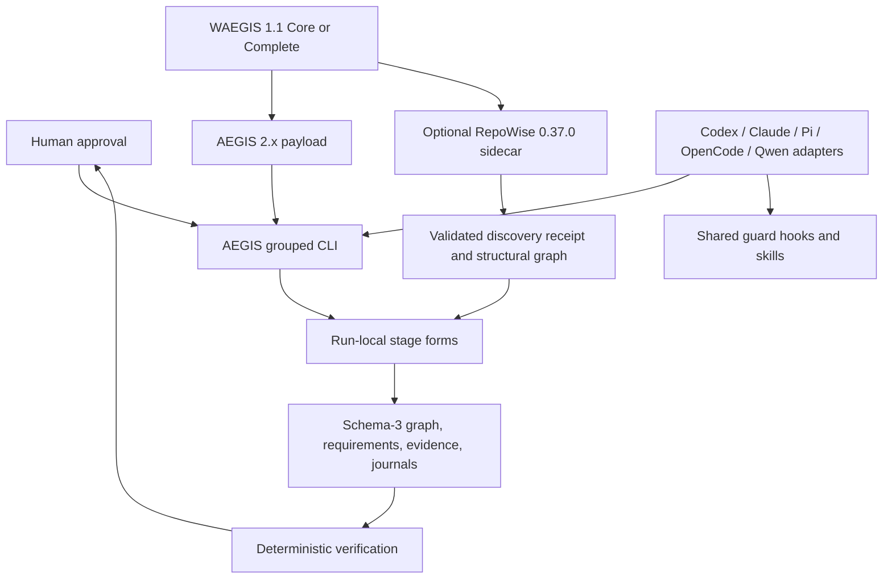
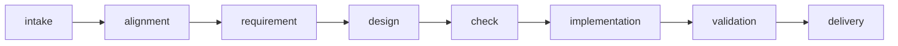

<!-- Copyright (c) 2026 DDP Engineering. SPDX-License-Identifier: LicenseRef-PolyForm-Noncommercial-1.0.0 -->

# Agentic Development Stack Architecture

> Date: July 29, 2026
> Status: AEGIS 2.1 / WAEGIS 1.1 architecture
> Configuration and run graph: schema 3
> Optional RepoWise integration: schema 1

## Purpose

AEGIS is the project-local governance and evidence runtime. WAEGIS is the
separate, stdlib-only deployment/configuration/repair tool and is never copied
into the payload. Host sandboxes and approvals remain independent.

The interface is file-first so small local models need to remember only a small
command vocabulary. Commands create, import, and navigate artifacts; detailed
intent, requirements, design, checks, and evidence live in generated schema-3
TOML and Markdown.

## Runtime Layers



## Command Boundary

Top-level AEGIS groups are exactly:

```text
run, stage, requirement, check, evidence, verify, delivery, adoption, config
```

Global options are `--run` and `--json`. Every text response gives status,
stage, artifact, and exact next command. AEGIS 1.x commands and flags are not
parsed, even as hidden aliases.

## Standard Run State Machine



Each stage uses `prepare → apply → close`; collection stages also use `add`.
Apply validates/imports without advancing. Close is the explicit human approval
action and prepares the successor. A control table carries access changes and
human-approved earlier routing. Delivery close records completion without an
outward Git or publication action.

Adoption retains its specialized seven stages but uses the same form lifecycle.

## Optional Repository Discovery Provider

WAEGIS has one codebase and two delivery editions. Core ships without RepoWise
and defaults it to disabled. Complete additionally carries a native, locked
RepoWise 0.37.0 runtime, exact source/provenance, notices, SBOM, hashes, and size
metadata. Either edition can link a validated external RepoWise 0.37.x command.

The target policy is the separate strict
`.agentic/integrations/repowise.toml` schema-1 file. Absence means disabled and
does not alter workflow/run-graph schema 3. WAEGIS owns installation and process
execution. AEGIS never imports RepoWise code or invokes its CLI.

After a successful sync, WAEGIS records version, source, profile, completion,
Git HEAD, worktree fingerprint, and graph/state digests. During
`repo-discovery`, AEGIS independently validates the policy, receipt, JSON
schemas, hashes, and fingerprints before writing normalized proposals to:

```text
.agentic/runs/<run-id>/discovery/repowise.json
```

Source roots, components, dependencies, entry points, and existing tests can
pre-populate empty discovery fields. Human-entered values are never silently
replaced. Advisory mode warns when data is missing/stale; required mode blocks.
RepoWise evidence remains provenance-bearing discovery input, not authoritative
workflow state.

## Persistence

Transient forms:

```text
.agentic/runs/<run-id>/stages/<stage>/
```

Always durable:

- schema-3 graph and journal;
- requirement snapshots and companion specs;
- `.agentic/runs/<run-id>/design.md`;
- check/evidence records and logs;
- validation summaries and delivery reports.

`interface.stage_form_retention` is `versioned`, `latest`, or `discard`.
`interface.check_execution` is `external` or `managed`. Both are captured at
prepare time so workspace policy cannot change midway through a revision.

## Requirement and Design Separation

Requirements contain externally observable behavior, acceptance criteria,
formats, errors, user text, state transitions, and non-functional constraints.
Internal architecture, component boundaries, algorithms, internal data,
compatibility strategy, sequence, and validation design belong in `design.md`.

The graph stores a `SolutionDesign` proposal with revision, document digest,
cited requirement snapshot digests, selected option, open questions, approval,
and timestamps. `INV-10` blocks check and later stages if approval is missing,
stale, or digest-invalid.

## Checks and Evidence

AEGIS generates requirement, check, evidence, and change IDs.

External check mode generates immutable commands in `evidence.toml`; the agent
records observed result, exit status, summary, and optional output log. Managed
mode executes imported commands. Check closure requires red; implementation
closure requires prior red and current green.

Bug fixes reproduce the exact observable failure. Checks identify applicable
production/mock/sandbox, feature-flag, role, platform, and persistence variants,
with parity assertions where promised. They cover response shapes, cleanup,
rollback, errors, boundaries, concurrency, and idempotency when relevant.

## Deterministic Verification

`verify run` orders:

1. impact analysis and focused/full-regression selection;
2. enabled build, typecheck, lint, test, security gates;
3. invariants, traceability, and coverage;
4. working-tree review;
5. validation summary for human diff review.

All enabled groups run even after failures. Disabled is a distinct status.
Security runs only explicit deterministic tooling and makes no general assurance
claim.

## Deployment Boundary

AEGIS is version 2.1.0. WAEGIS is 1.1.0 and supports AEGIS
`>=2.0.0,<3.0.0`. WAEGIS generates, inspects, configures, optionally executes,
and reports all five gates. Schema 2, old graphs, AEGIS 1.x payload upgrades,
and cross-major WAEGIS upgrades are rejected before mutation. A fresh 2.x
deployment is required.

Core-to-Complete is supported. Complete-to-Core is refused while a project
selects the bundled RepoWise runtime; reconfigure the project to external or
disabled first. Target-side install and indexing are offline. Complete artifacts
are built and tested natively per OS so targets never compile native
dependencies.

## Adapter Contract

Codex, Claude Code, Pi, OpenCode, and Qwen adapters remain thin. They point at
the shared skills and guard hooks, use the grouped CLI, and never maintain an
independent workflow state. Host Plan Mode may facilitate design discussion but
cannot approve a design or advance AEGIS.
