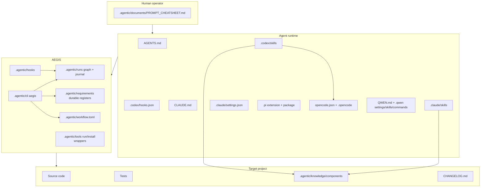
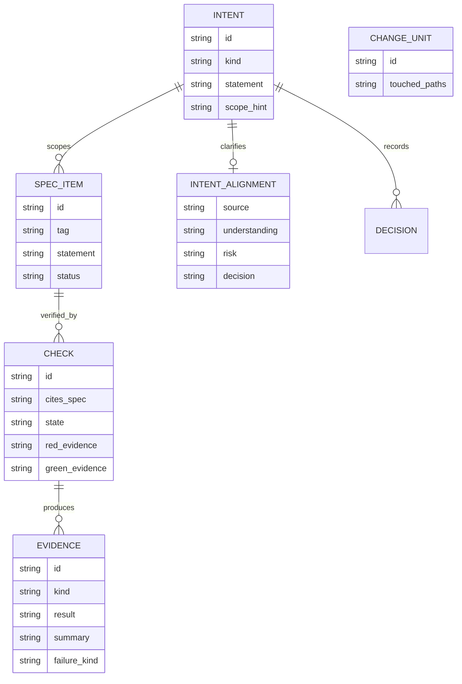

<!--
Copyright (c) 2026 DDP Engineering
This software is licensed under the PolyForm Noncommercial License 1.0.0.
Commercial use requires a separate commercial license.
See the LICENSE.txt file for full license details. SPDX-License-Identifier: LicenseRef-PolyForm-Noncommercial-1.0.0
-->

# Agentic Development Stack Architecture

> **Date**: July 20, 2026
> **Author**: Dan Pasare
> **Status**: Draft, aligned to the standalone AEGIS project.
> **Scope**: Architecture for AEGIS, a generic, copyable agentic engineering governance and integrity system.
> **Implementation target**: `05_Software/aegis/template/`.

## 1. Architecture Intent

This project packages a reusable method for agentic software development. A new
project can adopt it by copying the template files into its repository root or
by running `02_Tools/create_project_from_template.py`.

The architecture is designed for human-steered development agents. It does not
assume that the agent is fully autonomous. Instead, it gives the agent:

- a stable project-local workflow CLI;
- a durable workflow state under `.agentic/`;
- human-readable operating instructions in `AGENTS.md`;
- human operator prompt examples and references under `.agentic/documents/`
  (`PROMPT_CHEATSHEET.md`, `CLI_API_REFERENCE.md`, `How_To_Start_A_New_Project.md`,
  `WORKFLOW_CHEATSHEET.svg`);
- shared, platform-neutral skill procedures under `.agentic/skills/`;
- Codex skill and hook adapters under `.codex/`;
- Claude Code project memory, settings, hooks, and skill adapters under
  `CLAUDE.md` and `.claude/`;
- a Pi adapter and Pi package under `.pi/` (bridge extension plus a `pi.skills`
  manifest reusing `.agentic/skills/`);
- an OpenCode adapter under `.opencode/` plus `opencode.json` (project config,
  default workflow agent, native skill wrappers, command prompts, and a local
  plugin reusing `.agentic/hooks/`);
- a Qwen Code adapter under `.qwen/` plus `QWEN.md` (native `settings.json`
  command hooks reusing `.agentic/hooks/`, `context.fileName` pointing at
  `AGENTS.md`, skill wrappers, and command prompts);
- deterministic checks for invariants, traceability, coverage, impact, and
  delivery preflight;
- first-class Intent Alignment records that capture the agent's understanding,
  scope, assumptions, acceptance target, open questions, risk, and proceed/pause
  decision before requirement/spec work, including recommended responses for
  automated flow when questions remain;
- workflow-owned component knowledge under `.agentic/knowledge/components/`.

The current implementation is a **manual gate workflow with deterministic
guardrails**. A future implementation can add a fully automated conductor, but
the shipped template does not require one.

## 2. Delivered Project Shape

When the template is copied into a target repository, the target receives:

```text
.agentic/
  cli/
  documents/
    CLI_API_REFERENCE.md
    How_To_Start_A_New_Project.md
    PROMPT_CHEATSHEET.md
    WORKFLOW_CHEATSHEET.svg
  hooks/
  knowledge/
    components/
      component_template.md
      index.md
  registry/
  reports/
    adoption/
  requirements/
  skills/
  tools/
  components.toml
  workflow.toml
.codex/
  config.toml
  hooks.json
  skills/
.claude/
  agents/
  settings.json
  skills/
.pi/
  extensions/
    agentic-guard/
  package.json
  settings.json
  README.md
opencode.json
.opencode/
  commands/
  plugins/
    agentic-guard.mjs
  skills/
.qwen/
  commands/
  settings.json
  skills/
  README.md
AGENTS.md
CLAUDE.md
QWEN.md
CHANGELOG.md
```

The important split is:

- `.agentic/` is the generic workflow layer, including the shared skill
  procedures under `.agentic/skills/` and the operator-facing references under
  `.agentic/documents/`.
- `.codex/` is the Codex adapter layer.
- `.claude/` and `CLAUDE.md` are the Claude Code adapter layer.
- `.pi/` is the Pi adapter layer; it is simultaneously a Pi package and reuses
  `.agentic/skills/` through its `pi.skills` manifest (no skill duplication).
- `.opencode/` and `opencode.json` are the OpenCode adapter layer.
- `.qwen/` and `QWEN.md` are the Qwen Code adapter layer; its `settings.json`
  binds the shared hooks natively and points `context.fileName` at `AGENTS.md`.
- `.agentic/knowledge/components/` is the workflow-owned component
  documentation convention; `.agentic/components.toml` maps component scope and
  `.agentic/reports/` holds generated adoption reports.
- `CHANGELOG.md` is the target project's human release/change log.
- `.agentic/documents/PROMPT_CHEATSHEET.md` is the operator-facing prompt
  reference.

## 3. Runtime Layers



The workflow is portable because the core state and checks are plain files and
Python scripts. Codex receives extra automation through `.codex/skills` and
`.codex/hooks.json`. Claude Code receives project memory and automation through
`CLAUDE.md`, `.claude/settings.json`, and `.claude/skills`. Pi receives a bridge
extension and a Pi package under `.pi/` that map its tool events onto the same
`.agentic/hooks/` scripts and reuse `.agentic/skills/`. OpenCode receives
`opencode.json` plus a default `.opencode/agents/aegis.md` primary
agent, `.opencode/` skill wrappers, command prompts, and a local plugin that
maps `tool.execute.*` events onto the same hooks. Qwen Code receives
`QWEN.md` plus `.qwen/` skill wrappers and command prompts, and its native
`settings.json` `PreToolUse`/`PostToolUse` command hooks call the same
`.agentic/hooks/*.py` scripts directly (no bridge code, the same model as Codex
and Claude Code). Other agent
platforms can reuse the same `AGENTS.md`, `.agentic/` CLI, and docs, then bind
their own hook or skill mechanism. Human operators can use
`.agentic/documents/PROMPT_CHEATSHEET.md` as a prompt reference, but it is not an
authoritative agent behavior contract.

## 4. Execution Model

The workflow uses seven gates:

1. `intake`
2. `alignment`
3. `requirement`
4. `check`
5. `implementation`
6. `validation`
7. `delivery`

The gate order is intentionally explicit in the shipped template. The user can
ask the agent to stop at each gate, inspect the output, approve, revise, or
abort.

Existing-project adoption uses a parallel seven-stage route:

1. `adoption-intake`
2. `adoption-alignment`
3. `repo-discovery`
4. `component-map`
5. `component-adoption`
6. `baseline-review`
7. `adoption-delivery`

After `intake` and `adoption-intake`, the workflow enters `alignment` or
`adoption-alignment` before requirement/spec work or adoption discovery
proceeds. The record lives in `graph.json`, is appended to `journal.jsonl` as
`alignment.recorded`, and is controlled by `[alignment]` policy in
`.agentic/workflow.toml`. The stage can be skipped by setting
`[alignment].enabled = false`.

The conceptual design remains invariant-driven: a change is not deliverable
because the agent says it is done; it is deliverable only when deterministic
checks and recorded evidence show that the required invariants hold.

## 5. Artifact Graph

Each active run is stored under `.agentic/runs/<run-id>/graph.json`.



The graph records the current run. Durable project behavior is also captured in
Markdown requirement registers under `.agentic/requirements/`.

## 6. Invariants

The current CLI evaluates these invariants:

| ID | Name | Meaning | Default policy |
|---|---|---|---|
| `INV-1` | Coverage | Accepted or realized spec items have checks. | blocking |
| `INV-2` | Citation | Checks cite existing spec items. | blocking |
| `INV-3` | Red-before-green | Green checks have prior failing evidence. | blocking |
| `INV-4` | No regression | No failing implementation, validation, or delivery gate evidence. | blocking |
| `INV-5` | In scope | Recorded touched paths are under configured source, test, spec, documentation, or scope-hint roots. | advisory |
| `INV-6` | Evidence | The run has recorded evidence. | blocking |
| `INV-7` | Clean secrets | Configured secret patterns do not appear in the Git diff. | non-waivable |
| `INV-8` | Green requirements active | Green checks that cite durable requirements only cite `Active` requirement rows. | blocking |
| `INV-9` | Component baseline scope | Behavior-changing runs only touch mapped components that meet the configured adoption baseline or belong to an approved bundle. | blocking |

The invariants are deliberately small. They catch the most common failure modes:
unverified requirements, orphan tests, tests that never failed, missing
evidence, scope creep, secrets, durable requirements left `Planned`, and changes
to components that are not baseline-ready.

Invariant severities are currently fixed in `invariants.py`. The template ships
no declarative policy file, so tuning a severity means editing that module.

## 7. Durable Requirements And Regression Traceability

The workflow has two requirement layers:

- **Run spec items**: short-lived items in `graph.json`, created for the active
  feature, fix, or change.
- **Durable requirement rows**: long-lived Markdown rows under
  `.agentic/requirements/`.

Durable requirement rows are used by:

- `audit traceability` to verify linked tests resolve;
- `audit coverage` to detect coverable source files without test-linked
  requirement coverage;
- `impact` to map changed files to existing requirements and linked tests;
- `registry sync` and `registry audit` to refresh delivery-time caches.

This is what turns a one-off agent session into a maintainable project memory.

## 8. Component Documentation

New components and material component changes require documentation under
`.agentic/knowledge/components/`.

The template ships:

- `.agentic/knowledge/components/component_template.md`;
- `.agentic/knowledge/components/index.md`;
- `write-component-documentation` (Codex `$`, Claude Code `/`, Pi `/skill:`,
  OpenCode native `skill`, Qwen Code `/skills`);
- `documentation-audit` (Codex `$`, Claude Code `/`, Pi `/skill:`,
  OpenCode native `skill`, Qwen Code `/skills`);
- workflow config for `[documentation]`;
- implementation write-zone allowance for
  `.agentic/knowledge/components/**`.

Component documentation complements requirements and tests. It does not replace
durable requirement rows or linked verification.

## 9. Change Log And Delivery Records

The target project receives `CHANGELOG.md`. It is the human-facing release/change
log for notable project changes.

The workflow also generates per-run delivery records:

- `.agentic/runs/<run-id>/journal.jsonl`;
- `.agentic/runs/<run-id>/graph.json`;
- `.agentic/runs/<run-id>/report.md`;
- `.agentic/registry/*.json` after registry sync.

The changelog and the workflow report have different purposes:

- `CHANGELOG.md` summarizes user-visible or release-relevant change history.
- The workflow report records why a specific run is ready to deliver.
- Requirement registers preserve durable behavioral contracts.

## 10. Skills And Hooks

### Skills

The shared, platform-neutral skill procedures live once under
`.agentic/skills/`:

- `agentic-development`;
- `agentic-delivery`;
- `regression-traceability`;
- `write-component-documentation`;
- `documentation-audit`;
- `python-codestyle-audit`.

The five adapters point back to `AGENTS.md` and the matching
`.agentic/skills/<skill>/SKILL.md`, so the detailed workflow text has a single
maintenance source: Codex adapters under `.codex/skills/`, Claude Code adapters
under `.claude/skills/`, Pi reuse through the `.pi/` package's `pi.skills`
manifest pointing at `../.agentic/skills`, OpenCode adapters under
`.opencode/skills/`, and Qwen Code adapters under `.qwen/skills/`.
`.agentic/documents/PROMPT_CHEATSHEET.md` remains a human
operator reference. Direct Claude invocation uses `/skill-name`; Codex prompts
use `$skill-name`; Pi invokes them as `/skill:<name>`; OpenCode loads them with
the native `skill` tool; Qwen Code invokes them model-driven or from the
`/skills` picker.

### Hooks

The template delivers standalone Python hook scripts under `.agentic/hooks/` and
Codex hook bindings under `.codex/hooks.json`. Claude Code receives project hook
bindings through `.claude/settings.json`, Pi receives them through a TypeScript
bridge extension under `.pi/extensions/agentic-guard/`, and OpenCode receives
them through `.opencode/plugins/agentic-guard.mjs`, all using the same
`.agentic/hooks/*.py` scripts rather than duplicating hook logic. (Pi's
`pi.exec` cannot pass stdin, so the bridge spawns the hooks through Node's
`child_process`; OpenCode's plugin also spawns the hooks through Node.) Qwen Code
needs no bridge: its native `settings.json` `PreToolUse`/`PostToolUse` command
hooks invoke the same `.agentic/hooks/*.py` scripts directly, the same as Codex
and Claude Code. Qwen labels its file-writing tool `WriteFile`, which the shared
`guard_write_zone` hook accepts alongside the Codex `apply_patch` and Claude
`Edit`/`Write`/`MultiEdit` names.

The hook layer currently covers:

- write-zone checks for edit tools;
- secret-like input scanning for shell commands (and, under Pi and OpenCode,
  full write/edit content);
- delivery preflight before publish-like shell commands;
- protected-path read denial (under Pi and OpenCode, mirroring the `.claude`
  Read denies);
- journal logging after tool use.

Hooks are guardrails, not a complete sandbox. Shell commands can still create
files in ways that a simple edit-hook does not fully model. For unattended or
untrusted execution, use an external sandbox such as a container, VM, or locked
worktree policy.

## 11. Portability Model

The template supports three levels of portability:

| Layer | Portable? | Notes |
|---|---|---|
| `.agentic/cli` | Yes | Plain Python 3.11+, no third-party runtime dependencies. Git is required for the secret, working-tree, impact, and delivery checks. |
| `.agentic/tools` | Yes | PowerShell and Bash wrappers for Windows and Ubuntu 22+. |
| `.agentic/workflow.toml` | Yes | Project-specific roots, gates, secrets, write zones. |
| `.agentic/skills` | Yes | Shared, platform-neutral skill procedures; the single skill source. |
| `.agentic/hooks` | Mostly | Standalone Python scripts, but binding depends on the host agent. |
| `.codex/skills` | Codex adapter | Thin pointers to `.agentic/skills`; reusable by other agents. |
| `.codex/hooks.json` | Codex-specific | Codex binding for the shared hook scripts. |
| `CLAUDE.md` | Claude-specific | Project memory that points Claude Code back to `AGENTS.md`. |
| `.claude/settings.json` | Claude-specific | Claude Code binding for the shared hook scripts. |
| `.claude/skills` | Claude adapter | Thin pointers to `.agentic/skills`. |
| `.pi/extensions` | Pi adapter | TypeScript bridge that maps Pi tool events to the shared hook scripts. Requires Node and project trust. |
| `.pi/package.json` | Pi-specific | Pi package manifest; `pi.skills` reuses `.agentic/skills`. `private:true`, git/local install only. |
| `opencode.json` | OpenCode-specific | Project config for instructions, `default_agent`, skill permissions, and conservative path/command permissions. |
| `.opencode/agents` | OpenCode adapter | Primary workflow agent that loads the shared agentic development skill before behavior-changing work. |
| `.opencode/skills` | OpenCode adapter | Thin pointers to `.agentic/skills`. |
| `.opencode/plugins` | OpenCode adapter | Local JavaScript plugin that maps OpenCode tool events to the shared hook scripts. |
| `QWEN.md` | Qwen-specific | Adapter note that points Qwen Code back to `AGENTS.md`. |
| `.qwen/settings.json` | Qwen-specific | Native command-hook bindings for the shared hook scripts, `context.fileName` pointing at `AGENTS.md`, and permission denies. |
| `.qwen/skills` | Qwen adapter | Thin pointers to `.agentic/skills`. |

## 12. Known Weak Points

1. **Gate discipline is partly human/agent-driven.**
   The CLI records and checks state, but it does not yet prevent every command
   from being run in the wrong stage.

2. **Hook enforcement is host-specific.**
   Codex, Claude Code, Pi, OpenCode, and Qwen Code get useful hook bindings.
   Other agent runtimes need equivalent bindings. The Pi binding additionally
   requires Node and a project-trust step; the OpenCode binding requires OpenCode
   local plugin loading and a usable Python interpreter; the Qwen Code binding
   requires a usable Python interpreter and a project-trust step.

3. **Write-zone protection is cooperative.**
   It is good for normal edit flows, but it is not a hardened filesystem
   sandbox.

4. **Component documentation is procedural.**
   The workflow requires it, and scope rules allow it, but there is not yet a
   deterministic invariant that detects every missing component document.

5. **Workflow policy is fixed in code.**
   Invariant severities and the manual-gate model live in `invariants.py` and
   `AGENTS.md`. The template ships no declarative policy file, and no automated
   conductor that would consume one.

6. **Requirement tables are intentionally simple.**
   They are easy to review, but they rely on a stable Markdown table shape.

## 13. Evolution Path

The current template is useful as a manual, auditable workflow. The next
evolution steps are:

1. Implement the ratified parallel-branch simplification so concurrent work is
   isolated by worktree and run state without adding a database or lock files.
2. Add stronger stage validation around CLI commands when it can preserve the
   manual stop-and-review model.
3. Revisit an advisory component-documentation check after component mappings
   and parallel-run state are stable.
4. Provide adapters for additional agent platforms (Codex, Claude Code, Pi,
   OpenCode, and Qwen Code are supported today).

An auto-advancing conductor, fail-closed hooks, and a declarative invariant
severity file are deliberately not part of the current roadmap. They would
weaken the manual-gate product contract or add policy surface without proven
demand.

## 14. Summary

The architecture packages agentic development as a copied project workflow:
local CLI, durable state, requirements, prompts, component documentation,
guardrails, and delivery preflight. Its current strength is not full autonomy;
its strength is that a human and an agent can work through software changes in a
repeatable, inspectable, evidence-backed way.
