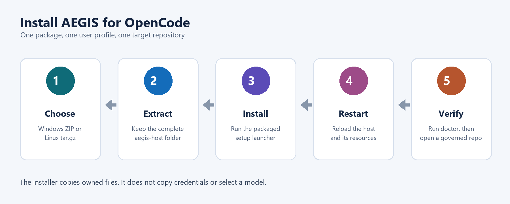
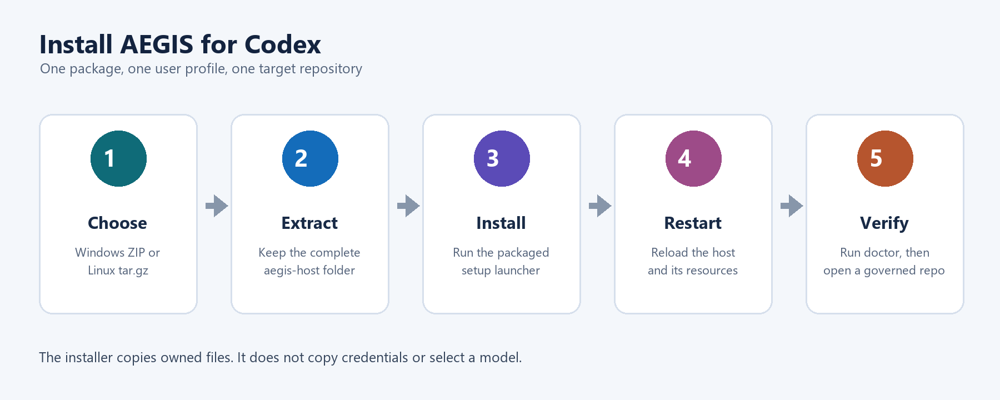
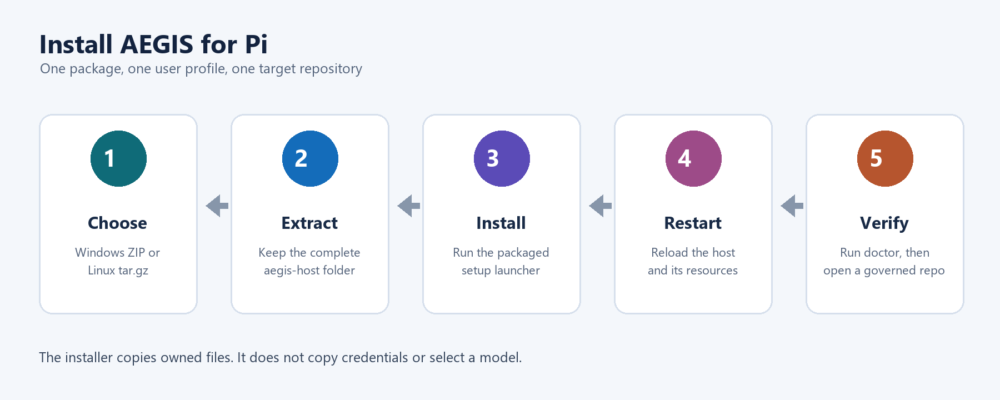
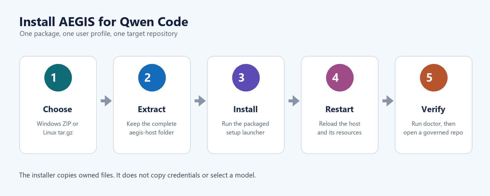

<!--
Copyright (c) 2026 DDP Engineering
Licensed under the PolyForm Noncommercial License 1.0.0; see LICENSE.txt.
SPDX-License-Identifier: LicenseRef-PolyForm-Noncommercial-1.0.0
-->

# AEGIS plugin installation manual

**Source version:** AEGIS 0.14.0
**Applies to:** complete packages assembled from the matching source
**Hosts:** OpenCode, Codex, Pi, Qwen Code and Claude Code

This manual combines the five standalone installation guides. Choose the chapter for the harness being configured. Install the AEGIS core into each target repository and the matching plugin into each user’s harness profile. Do not distribute an installed profile, `runtime.json`, credentials or another person’s sign-in.

## Choose a chapter

| Host | Main entry after installation | Standalone guide |
|---|---|---|
| OpenCode | Aegis agent and `/aegis-*` commands | [OpenCode](01_OpenCode_Installation.md) |
| Codex | `aegis:aegis` skill in a new task | [Codex](02_Codex_Installation.md) |
| Pi | `/aegis-*` commands and skill | [Pi](03_Pi_Installation.md) |
| Qwen Code | `/aegis-*`, review agents and MCP | [Qwen Code](04_Qwen_Code_Installation.md) |
| Claude Code | `/aegis:*`, skill, agents, MCP and hooks | [Claude Code](05_Claude_Code_Installation.md) |

## Shared package rule

Select the actual supplied package for the host and operating system, verify its checksum manifest, extract it completely, and run its own installer. The package manifest identifies its version. The [agent package guide](../Agent_Plugins.md) documents assembly from source. Every recipient authenticates their host independently. Project core installation and host plugin installation are separate operations.

<!-- PAGE BREAK -->

# Install AEGIS for OpenCode

**Source version:** AEGIS 0.14.0
**Applies to:** complete packages assembled from the matching source
**Platforms:** Windows and Linux; environment limits are called out below
**Audience:** each person installing AEGIS in their own host profile

This guide installs the complete AEGIS package for OpenCode in the user's host profile. Repository Git operations and package publication require their own authority.



*Figure 1. Use the package that matches the host and operating system; then verify it before opening a governed repository.*

## Before you begin

AEGIS has two separate parts:

1. The **core workflow** belongs in every target Git repository as `.agentic/`.
2. The **host plugin** belongs in each user’s harness profile and provides the AEGIS entry points.

Use the core payload from the supplied release, or `05_Software/aegis/template/.agentic/` when installing from this source checkout. Copy `.agentic/` to the target repository root, then run:

```text
python .agentic/aegis.py init
```

`init` creates each missing `context/project.md` and `context/environment.md` and preserves existing project files. Populate verified current purpose, responsibilities and setup during frame/adoption. Keep proposals in draft/task records and history in journals/Git. Configure actual verification commands and layout in `.agentic/aegis.toml`; see [Project context](../Project_Context.md).

Use `python3` on Linux when that is the available command. Git, Python 3.11+ and Node.js 22+ must be visible to the harness. Install and authenticate the host application with the user’s own account/provider first. The AEGIS package includes no subscription, API key, model configuration or machine-specific runtime settings.

Verify an archive against the checksum manifest supplied with that delivery. Use a complete assembled package with its shared libraries. The package manifest and README identify the actual version and supported installation options.


## 1. Choose and extract the package

Select the complete package for this host and operating system from the supplied delivery. Extract the archive completely. The resulting folder is named `aegis-opencode` and must contain `setup.mjs`, `Install-AEGIS.cmd`, `install.sh`, `README.md` and `lib/` or `plugins/aegis/lib/`.

Do not run installation from inside the ZIP viewer. Open a terminal in the extracted package directory.

## 2. Install for this user

Windows users can double-click `Install-AEGIS.cmd`. Linux users can run:

```sh
sh install.sh
```

The equivalent command on both platforms is:

```text
node setup.mjs install
```

The owned package is copied beneath `OPENCODE_CONFIG_DIR`, or the OpenCode user configuration directory selected by `XDG_CONFIG_HOME`. Unrelated configuration and credentials are preserved. If automatic discovery needs help, use:

```text
node setup.mjs install --config-dir <open-code-config>
```

Executable and profile paths may contain spaces; quote them in the active shell.

## 3. Restart and find AEGIS

Restart the OpenCode backend. In Desktop or TUI, choose **Aegis** in the agent selector. Use `/aegis-status` and `/aegis-start <software request>`. For noninteractive CLI use `opencode run --agent aegis "<request>"`.

Desktop, CLI and TUI use the same installation only when they use the same backend and configuration directory. WSL, SSH and remote backends require installation in that environment.


## 4. Verify without invoking a model

From the extracted package directory run:

```text
node setup.mjs doctor
```

`node setup.mjs doctor` reports the runtime, three agents, five commands, twelve tools and `models_invoked: false`.
`doctor` checks runtime and registration metadata. It does not prove that Desktop has rendered the plugin or that a model-led workflow is correct. For acceptance, open a fresh session in a disposable governed repository, confirm the AEGIS resources are visible, and perform only a user-authorized workflow with the user’s selected provider.

## 5. Update or remove

Extract the replacement package into a new directory, then use the same profile arguments as the original installation:

```text
node setup.mjs update
node setup.mjs uninstall
```

Update and removal refuse edited/missing owned files and active or uncertain verification jobs. Preserve customizations outside the managed package. A Windows installation does not configure WSL; install separately inside each environment.

## Troubleshooting

1. If **Aegis** is absent, restart the backend and rerun `doctor` from the extracted package.
2. Remove old manual AEGIS entries from `opencode.json`/`opencode.jsonc`; the installer refuses conflicts and does not rewrite those files.
3. Do not configure the local package both as an npm plugin and through this installer.
4. If Node.js, Python or Git is not found from Desktop, rerun `install`/`update` with absolute `--node`, `--python` and applicable profile/host paths.
5. If update reports an owned-file conflict, preserve the changed files, restore the installed package to a known state, then retry. Do not delete the ownership record to bypass the check.

## What success looks like

- `node setup.mjs doctor` exits successfully and reports `models_invoked: false`.
- A new OpenCode session discovers the documented AEGIS resources.
- The target repository contains its own `.agentic/aegis.py` and `python .agentic/aegis.py status --json` succeeds.
- The user’s host authentication and model choice remain their own.

## Primary references

- [OpenCode plugins](https://opencode.ai/v2/docs/plugins)
- [OpenCode agents](https://opencode.ai/v2/docs/agents)

For AEGIS-specific behavior, use the supplied package's `README.md`, the installed core contract and [agent plugin guide](../Agent_Plugins.md). Dated verification evidence belongs in [delivery records](../../07_Delivery/README.md), separately from these setup instructions.

<!-- PAGE BREAK -->

# Install AEGIS for Codex

**Source version:** AEGIS 0.14.0
**Applies to:** complete packages assembled from the matching source
**Platforms:** Windows and Linux; environment limits are called out below
**Audience:** each person installing AEGIS in their own host profile

This guide installs the complete AEGIS package for Codex in the user's host profile. Repository Git operations and package publication require their own authority.



*Figure 1. Use the package that matches the host and operating system; then verify it before opening a governed repository.*

## Before you begin

AEGIS has two separate parts:

1. The **core workflow** belongs in every target Git repository as `.agentic/`.
2. The **host plugin** belongs in each user’s harness profile and provides the AEGIS entry points.

Use the core payload from the supplied release, or `05_Software/aegis/template/.agentic/` when installing from this source checkout. Copy `.agentic/` to the target repository root, then run:

```text
python .agentic/aegis.py init
```

`init` creates each missing `context/project.md` and `context/environment.md` and preserves existing project files. Populate verified current purpose, responsibilities and setup during frame/adoption. Keep proposals in draft/task records and history in journals/Git. Configure actual verification commands and layout in `.agentic/aegis.toml`; see [Project context](../Project_Context.md).

Use `python3` on Linux when that is the available command. Git, Python 3.11+ and Node.js 22+ must be visible to the harness. Install and authenticate the host application with the user’s own account/provider first. The AEGIS package includes no subscription, API key, model configuration or machine-specific runtime settings.

Verify an archive against the checksum manifest supplied with that delivery. Use a complete assembled package with its shared libraries. The package manifest and README identify the actual version and supported installation options.


## 1. Choose and extract the package

Select the complete package for this host and operating system from the supplied delivery. Extract the archive completely. The resulting folder is named `aegis-codex` and must contain `setup.mjs`, `Install-AEGIS.cmd`, `install.sh`, `README.md` and `lib/` or `plugins/aegis/lib/`.

Do not run installation from inside the ZIP viewer. Open a terminal in the extracted package directory.

## 2. Install for this user

Windows users can double-click `Install-AEGIS.cmd`. Linux users can run:

```sh
sh install.sh
```

The equivalent command on both platforms is:

```text
node setup.mjs install
```

The owned package is copied beneath `CODEX_HOME` (normally `~/.codex`), including a local AEGIS marketplace, native plugin cache and two review-role files. Unrelated configuration and credentials are preserved. If automatic discovery needs help, use:

```text
node setup.mjs install --codex-home <codex-home> --codex <codex-executable-or-codex.js>
```

Executable and profile paths may contain spaces; quote them in the active shell.

## 3. Restart and find AEGIS

Start a **new Codex task** in the target repository. Invoke the namespaced **`aegis:aegis` skill**, or ask: “Use the AEGIS skill to inspect this project and show its task status.” Codex does not add an OpenCode-style primary-agent selector.

The plugin is available in supported Codex app and CLI environments that read the same `CODEX_HOME`. A fresh task is needed for discovery. The current Codex plugin browser can display installed plugins; this package’s installer performs its local marketplace registration through the Codex CLI.


## 4. Verify without invoking a model

From the extracted package directory run:

```text
node setup.mjs doctor
```

`node setup.mjs doctor` reports Codex, the `aegis` plugin and skill, both review roles, and `models_invoked: false`.
`doctor` checks runtime and registration metadata. It does not prove that Desktop has rendered the plugin or that a model-led workflow is correct. For acceptance, open a fresh session in a disposable governed repository, confirm the AEGIS resources are visible, and perform only a user-authorized workflow with the user’s selected provider.

## 5. Update or remove

Extract the replacement package into a new directory, then use the same profile arguments as the original installation:

```text
node setup.mjs update
node setup.mjs uninstall
```

Update and removal refuse edited/missing owned files and active or uncertain verification jobs. Preserve customizations outside the managed package. A Windows installation does not configure WSL; install separately inside each environment.

## Troubleshooting

1. If the skill is missing, close the current task, restart Codex and open a new task.
2. A different marketplace named `personal` is preserved and causes installation to stop. Resolve that catalog-name conflict explicitly.
3. Install the built archive. A raw source directory lacks the copied `plugins/aegis/lib/bridge.mjs`.
4. If Node.js, Python or Git is not found from Desktop, rerun `install`/`update` with absolute `--node`, `--python` and applicable profile/host paths.
5. If update reports an owned-file conflict, preserve the changed files, restore the installed package to a known state, then retry. Do not delete the ownership record to bypass the check.

## What success looks like

- `node setup.mjs doctor` exits successfully and reports `models_invoked: false`.
- A new Codex session discovers the documented AEGIS resources.
- The target repository contains its own `.agentic/aegis.py` and `python .agentic/aegis.py status --json` succeeds.
- The user’s host authentication and model choice remain their own.

## Primary references

- [OpenAI plugins](https://learn.chatgpt.com/docs/plugins)
- [Codex plugin packaging](https://developers.openai.com/plugins/build/plugins)

For AEGIS-specific behavior, use the supplied package's `README.md`, the installed core contract and [agent plugin guide](../Agent_Plugins.md). Dated verification evidence belongs in [delivery records](../../07_Delivery/README.md), separately from these setup instructions.

<!-- PAGE BREAK -->

# Install AEGIS for Pi

**Source version:** AEGIS 0.14.0
**Applies to:** complete packages assembled from the matching source
**Platforms:** Windows and Linux; environment limits are called out below
**Audience:** each person installing AEGIS in their own host profile

This guide installs the complete AEGIS package for Pi in the user's host profile. Repository Git operations and package publication require their own authority.



*Figure 1. Use the package that matches the host and operating system; then verify it before opening a governed repository.*

## Before you begin

AEGIS has two separate parts:

1. The **core workflow** belongs in every target Git repository as `.agentic/`.
2. The **host plugin** belongs in each user’s harness profile and provides the AEGIS entry points.

Use the core payload from the supplied release, or `05_Software/aegis/template/.agentic/` when installing from this source checkout. Copy `.agentic/` to the target repository root, then run:

```text
python .agentic/aegis.py init
```

`init` creates each missing `context/project.md` and `context/environment.md` and preserves existing project files. Populate verified current purpose, responsibilities and setup during frame/adoption. Keep proposals in draft/task records and history in journals/Git. Configure actual verification commands and layout in `.agentic/aegis.toml`; see [Project context](../Project_Context.md).

Use `python3` on Linux when that is the available command. Git, Python 3.11+ and Node.js 22+ must be visible to the harness. Install and authenticate the host application with the user’s own account/provider first. The AEGIS package includes no subscription, API key, model configuration or machine-specific runtime settings.

Verify an archive against the checksum manifest supplied with that delivery. Use a complete assembled package with its shared libraries. The package manifest and README identify the actual version and supported installation options.


## 1. Choose and extract the package

Select the complete package for this host and operating system from the supplied delivery. Extract the archive completely. The resulting folder is named `aegis-pi` and must contain `setup.mjs`, `Install-AEGIS.cmd`, `install.sh`, `README.md` and `lib/` or `plugins/aegis/lib/`.

Do not run installation from inside the ZIP viewer. Open a terminal in the extracted package directory.

## 2. Install for this user

Windows users can double-click `Install-AEGIS.cmd`. Linux users can run:

```sh
sh install.sh
```

The equivalent command on both platforms is:

```text
node setup.mjs install
```

The owned package is copied beneath `PI_CODING_AGENT_DIR/extensions/aegis` (normally `~/.pi/agent/extensions/aegis`). Unrelated configuration and credentials are preserved. If automatic discovery needs help, use:

```text
node setup.mjs install --config-dir <pi-config> --host-cli <pi-executable-or-cli.js>
```

Executable and profile paths may contain spaces; quote them in the active shell.

## 3. Restart and find AEGIS

Restart Pi in the target repository. Use `/aegis-status`, `/aegis-start <software request>`, `/aegis-resume TASK-<id>`, `/aegis-check` and `/aegis-validate TASK-<id>`. Pi supplies a skill and twelve workflow operations; it does not add an OpenCode-style primary-agent selector.

Pi is a terminal harness. Install separately in Windows, Linux, WSL, SSH or other environments because each has its own configuration and executable paths.


## 4. Verify without invoking a model

From the extracted package directory run:

```text
node setup.mjs doctor
```

`node setup.mjs doctor` reports Pi, five commands, twelve tools and `models_invoked: false`.
`doctor` checks runtime and registration metadata. It does not prove that Desktop has rendered the plugin or that a model-led workflow is correct. For acceptance, open a fresh session in a disposable governed repository, confirm the AEGIS resources are visible, and perform only a user-authorized workflow with the user’s selected provider.

## 5. Update or remove

Extract the replacement package into a new directory, then use the same profile arguments as the original installation:

```text
node setup.mjs update
node setup.mjs uninstall
```

Update and removal refuse edited/missing owned files and active or uncertain verification jobs. Preserve customizations outside the managed package. A Windows installation does not configure WSL; install separately inside each environment.

## Troubleshooting

1. On Windows, `--host-cli` must name the executable or JavaScript CLI entry, not a `.cmd`, `.bat` or `.ps1` shim.
2. If the commands are absent, confirm the files exist below `PI_CODING_AGENT_DIR/extensions/aegis`, then restart Pi.
3. Pi review helpers start separate sessions and use the user’s configured model; `doctor` does not start them.
4. If Node.js, Python or Git is not found from Desktop, rerun `install`/`update` with absolute `--node`, `--python` and applicable profile/host paths.
5. If update reports an owned-file conflict, preserve the changed files, restore the installed package to a known state, then retry. Do not delete the ownership record to bypass the check.

## What success looks like

- `node setup.mjs doctor` exits successfully and reports `models_invoked: false`.
- A new Pi session discovers the documented AEGIS resources.
- The target repository contains its own `.agentic/aegis.py` and `python .agentic/aegis.py status --json` succeeds.
- The user’s host authentication and model choice remain their own.

## Primary references

- [Pi documentation](https://github.com/earendil-works/pi/blob/main/packages/coding-agent/docs/index.md)
- [Pi packages and extensions](https://github.com/earendil-works/pi/blob/main/packages/coding-agent/README.md)

For AEGIS-specific behavior, use the supplied package's `README.md`, the installed core contract and [agent plugin guide](../Agent_Plugins.md). Dated verification evidence belongs in [delivery records](../../07_Delivery/README.md), separately from these setup instructions.

<!-- PAGE BREAK -->

# Install AEGIS for Qwen Code

**Source version:** AEGIS 0.14.0
**Applies to:** complete packages assembled from the matching source
**Platforms:** Windows and Linux; environment limits are called out below
**Audience:** each person installing AEGIS in their own host profile

This guide installs the complete AEGIS package for Qwen Code in the user's host profile. Repository Git operations and package publication require their own authority.



*Figure 1. Use the package that matches the host and operating system; then verify it before opening a governed repository.*

## Before you begin

AEGIS has two separate parts:

1. The **core workflow** belongs in every target Git repository as `.agentic/`.
2. The **host plugin** belongs in each user’s harness profile and provides the AEGIS entry points.

Use the core payload from the supplied release, or `05_Software/aegis/template/.agentic/` when installing from this source checkout. Copy `.agentic/` to the target repository root, then run:

```text
python .agentic/aegis.py init
```

`init` creates each missing `context/project.md` and `context/environment.md` and preserves existing project files. Populate verified current purpose, responsibilities and setup during frame/adoption. Keep proposals in draft/task records and history in journals/Git. Configure actual verification commands and layout in `.agentic/aegis.toml`; see [Project context](../Project_Context.md).

Use `python3` on Linux when that is the available command. Git, Python 3.11+ and Node.js 22+ must be visible to the harness. Install and authenticate the host application with the user’s own account/provider first. The AEGIS package includes no subscription, API key, model configuration or machine-specific runtime settings.

Verify an archive against the checksum manifest supplied with that delivery. Use a complete assembled package with its shared libraries. The package manifest and README identify the actual version and supported installation options.


## 1. Choose and extract the package

Select the complete package for this host and operating system from the supplied delivery. Extract the archive completely. The resulting folder is named `aegis-qwen` and must contain `setup.mjs`, `Install-AEGIS.cmd`, `install.sh`, `README.md` and `lib/` or `plugins/aegis/lib/`.

Do not run installation from inside the ZIP viewer. Open a terminal in the extracted package directory.

## 2. Install for this user

Windows users can double-click `Install-AEGIS.cmd`. Linux users can run:

```sh
sh install.sh
```

The equivalent command on both platforms is:

```text
node setup.mjs install
```

The owned package is copied beneath `QWEN_HOME/extensions/aegis` (normally `~/.qwen/extensions/aegis`). Unrelated configuration and credentials are preserved. If automatic discovery needs help, use:

```text
node setup.mjs install --config-dir <qwen-config> --host-cli <qwen-executable-or-cli.js>
```

Executable and profile paths may contain spaces; quote them in the active shell.

## 3. Restart and find AEGIS

Restart Qwen Code in the target repository. Use `qwen extensions list` to see resources and `qwen mcp list` to check the local MCP connection. A session provides `/aegis-start`, `/aegis-resume`, `/aegis-status`, `/aegis-check` and `/aegis-validate` plus two review agents.

The AEGIS package installs into the Qwen Code harness. If using the Qwen Code Companion in VS Code, restart the Qwen session after installation; the Companion itself is a separate IDE integration.


## 4. Verify without invoking a model

From the extracted package directory run:

```text
node setup.mjs doctor
```

`node setup.mjs doctor` reports Qwen Code, five commands, twelve tools, two reviewers and `models_invoked: false`.
`doctor` checks runtime and registration metadata. It does not prove that Desktop has rendered the plugin or that a model-led workflow is correct. For acceptance, open a fresh session in a disposable governed repository, confirm the AEGIS resources are visible, and perform only a user-authorized workflow with the user’s selected provider.

## 5. Update or remove

Extract the replacement package into a new directory, then use the same profile arguments as the original installation:

```text
node setup.mjs update
node setup.mjs uninstall
```

Update and removal refuse edited/missing owned files and active or uncertain verification jobs. Preserve customizations outside the managed package. A Windows installation does not configure WSL; install separately inside each environment.

## Troubleshooting

1. On Windows, `--host-cli` must name the executable or JavaScript CLI entry, not a shell shim.
2. If the MCP connection is absent, rerun `doctor`, check `qwen mcp list`, and restart Qwen Code.
3. Do not mix this owned-file installer with another installation of the same extension.
4. If Node.js, Python or Git is not found from Desktop, rerun `install`/`update` with absolute `--node`, `--python` and applicable profile/host paths.
5. If update reports an owned-file conflict, preserve the changed files, restore the installed package to a known state, then retry. Do not delete the ownership record to bypass the check.

## What success looks like

- `node setup.mjs doctor` exits successfully and reports `models_invoked: false`.
- A new Qwen Code session discovers the documented AEGIS resources.
- The target repository contains its own `.agentic/aegis.py` and `python .agentic/aegis.py status --json` succeeds.
- The user’s host authentication and model choice remain their own.

## Primary references

- [Qwen Code extensions](https://github.com/QwenLM/qwen-code/blob/main/docs/users/extension/introduction.md)
- [Qwen Code overview](https://github.com/QwenLM/qwen-code/blob/main/docs/users/overview.md)

For AEGIS-specific behavior, use the supplied package's `README.md`, the installed core contract and [agent plugin guide](../Agent_Plugins.md). Dated verification evidence belongs in [delivery records](../../07_Delivery/README.md), separately from these setup instructions.

<!-- PAGE BREAK -->

# Install AEGIS for Claude Code

**Source version:** AEGIS 0.14.0
**Applies to:** complete packages assembled from the matching source
**Platforms:** Windows and Linux; environment limits are called out below
**Audience:** each person installing AEGIS in their own host profile

This guide installs the complete AEGIS package for Claude Code in the user's host profile. Repository Git operations and package publication require their own authority.


*Figure 1. Use the package that matches the host and operating system; then verify it before opening a governed repository.*

## Before you begin

AEGIS has two separate parts:

1. The **core workflow** belongs in every target Git repository as `.agentic/`.
2. The **host plugin** belongs in each user’s harness profile and provides the AEGIS entry points.

Use the core payload from the supplied release, or `05_Software/aegis/template/.agentic/` when installing from this source checkout. Copy `.agentic/` to the target repository root, then run:

```text
python .agentic/aegis.py init
```

`init` creates each missing `context/project.md` and `context/environment.md` and preserves existing project files. Populate verified current purpose, responsibilities and setup during frame/adoption. Keep proposals in draft/task records and history in journals/Git. Configure actual verification commands and layout in `.agentic/aegis.toml`; see [Project context](../Project_Context.md).

Use `python3` on Linux when that is the available command. Git, Python 3.11+ and Node.js 22+ must be visible to the harness. Install and authenticate the host application with the user’s own account/provider first. The AEGIS package includes no subscription, API key, model configuration or machine-specific runtime settings.

Verify an archive against the checksum manifest supplied with that delivery. Use a complete assembled package with its shared libraries. The package manifest and README identify the actual version and supported installation options.


## 1. Choose and extract the package

Select the complete package for this host and operating system from the supplied delivery. Extract the archive completely. The resulting folder is named `aegis-claude` and must contain `setup.mjs`, `Install-AEGIS.cmd`, `install.sh`, `README.md` and `lib/` or `plugins/aegis/lib/`.

Do not run installation from inside the ZIP viewer. Open a terminal in the extracted package directory.

## 2. Install for this user

Windows users can double-click `Install-AEGIS.cmd`. Linux users can run:

```sh
sh install.sh
```

The equivalent command on both platforms is:

```text
node setup.mjs install
```

The owned package is copied beneath `CLAUDE_CONFIG_DIR` (normally `~/.claude`), including a local marketplace and the native user-scoped plugin cache. Unrelated configuration and credentials are preserved. If automatic discovery needs help, use:

```text
node setup.mjs install --config-dir <claude-config> --host-cli <claude-executable>
```

Executable and profile paths may contain spaces; quote them in the active shell.

## 3. Restart and find AEGIS

Restart Claude Code. In CLI or a supported local Desktop **Code** session, use `/aegis:start <software request>`, `/aegis:status`, `/aegis:resume TASK-<id>`, `/aegis:check` and `/aegis:validate TASK-<id>`. The plugin also supplies `aegis:workflow`, two review agents, twelve MCP operations and two advisory hooks.

Claude Desktop local Code sessions can manage installed plugins through **+ → Plugins** and use slash commands through the prompt controls. Use a native local Desktop Code session for the desktop plugin, and a separate Claude Code CLI installation for WSL. Remote support depends on the current Claude environment.


## 4. Verify without invoking a model

From the extracted package directory run:

```text
node setup.mjs doctor
```

`node setup.mjs doctor` checks installed registration and runtime metadata with `models_invoked: false`. Run it in the profile where this package is installed.

`doctor` checks runtime and registration metadata. It does not prove that Desktop has rendered the plugin or that a model-led workflow is correct. For acceptance, open a fresh session in a disposable governed repository, confirm the AEGIS resources are visible, and perform only a user-authorized workflow with the user’s selected provider.

## 5. Update or remove

Extract the replacement package into a new directory, then use the same profile arguments as the original installation:

```text
node setup.mjs update
node setup.mjs uninstall
```

Update and removal refuse edited/missing owned files and active or uncertain verification jobs. Preserve customizations outside the managed package. A Windows installation does not configure WSL; install separately inside each environment.

## Troubleshooting

1. Claude Code 2.1.259 or newer is required by this package’s tested hook/lifecycle format.
2. Install the complete built archive; the raw source marketplace does not contain `plugins/aegis/lib/bridge.mjs`.
3. Run setup as the person who will use Claude. The package does not include a subscription, account, API key or another user’s `runtime.json`.
4. If Node.js, Python or Git is not found from Desktop, rerun `install`/`update` with absolute `--node`, `--python` and applicable profile/host paths.
5. If update reports an owned-file conflict, preserve the changed files, restore the installed package to a known state, then retry. Do not delete the ownership record to bypass the check.

## What success looks like

- `node setup.mjs doctor` exits successfully and reports `models_invoked: false`.
- A new Claude Code session discovers the documented AEGIS resources.
- The target repository contains its own `.agentic/aegis.py` and `python .agentic/aegis.py status --json` succeeds.
- The user’s host authentication and model choice remain their own.

## Primary references

- [Claude Code plugins](https://code.claude.com/docs/en/plugins-reference)
- [Claude Code Desktop](https://code.claude.com/docs/en/desktop)

For AEGIS-specific behavior, use the supplied package's `README.md`, the installed core contract and [agent plugin guide](../Agent_Plugins.md). Dated verification evidence belongs in [delivery records](../../07_Delivery/README.md), separately from these setup instructions.
