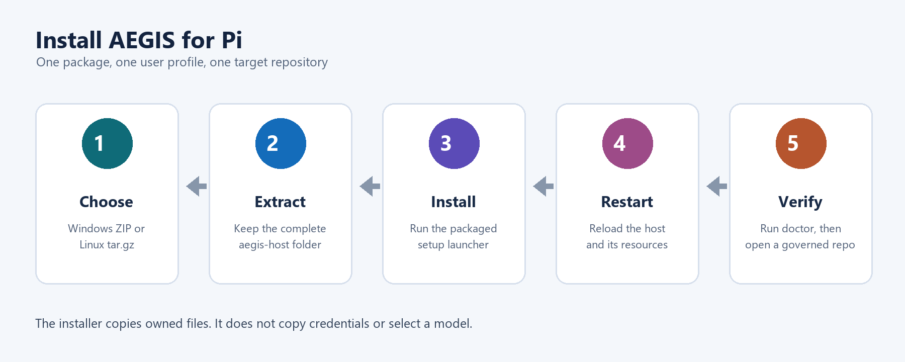
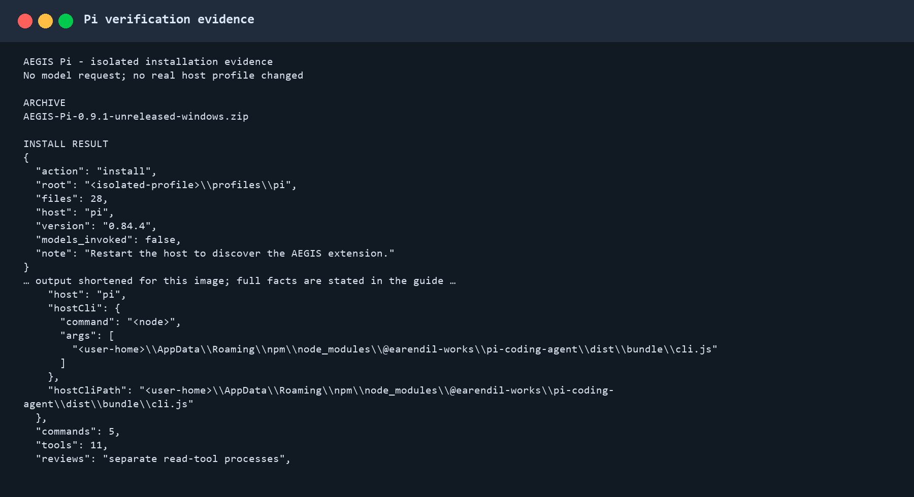

<!--
Copyright (c) 2026 DDP Engineering
Licensed under the PolyForm Noncommercial License 1.0.0; see LICENSE.txt.
SPDX-License-Identifier: LicenseRef-PolyForm-Noncommercial-1.0.0
-->

# Install AEGIS for Pi

**Applies to:** AEGIS 0.11.0 release package
**Platforms:** Windows and Linux; environment limits are called out below
**Audience:** each person installing AEGIS in their own host profile

This guide installs the complete AEGIS package for Pi. It does not publish the plugin or modify the selected project’s Git history.



*Figure 1. Use the package that matches the host and operating system; then verify it before opening a governed repository.*

## Before you begin

AEGIS has two separate parts:

1. The **core workflow** belongs in every target Git repository as `.agentic/`.
2. The **host plugin** belongs in each user’s harness profile and provides the AEGIS entry points.

Install the core from `aegis-0.11.0-windows.zip` or `aegis-0.11.0-linux.tar.gz`. Copy its `.agentic/` directory to the repository root, then run:

```text
python .agentic/aegis.py init
```

Use `python3` on Linux when that is the available command. Git, Python 3.11+ and Node.js 22+ must be visible to the harness. Install and authenticate the host application with the user’s own account/provider first. The AEGIS package includes no subscription, API key, model configuration or machine-specific runtime settings.

Verify the archive digest against `07_Delivery/dist/SHA256SUMS`. Do not use a raw integration source directory: only the assembled delivery archive contains the complete shared library.


## 1. Choose and extract the package

Use `AEGIS-Pi-0.11.0-windows.zip` on Windows or `AEGIS-Pi-0.11.0-linux.tar.gz` on Linux. Extract the archive completely. The resulting folder is named `aegis-pi` and must contain `setup.mjs`, `Install-AEGIS.cmd`, `install.sh`, `README.md` and `lib/` or `plugins/aegis/lib/`.

Do not run installation from inside the ZIP viewer. Open a terminal in the extracted package directory.

## 2. Install for this user

Windows users can double-click `Install-AEGIS.cmd`. Linux users can run:

```sh
sh install.sh
```

The equivalent command on both platforms is:

```text
node setup.mjs install
```

The owned package is copied beneath `PI_CODING_AGENT_DIR/extensions/aegis` (normally `~/.pi/agent/extensions/aegis`). Unrelated configuration and credentials are preserved. If automatic discovery needs help, use:

```text
`node setup.mjs install --config-dir <pi-config> --host-cli <pi-executable-or-cli.js>`
```

Executable and profile paths may contain spaces; quote them in the active shell.

## 3. Restart and find AEGIS

Restart Pi in the target repository. Use `/aegis-status`, `/aegis-start <software request>`, `/aegis-resume TASK-<id>`, `/aegis-check` and `/aegis-validate TASK-<id>`. Pi supplies a skill and eleven workflow operations; it does not add an OpenCode-style primary-agent selector.

Pi is a terminal harness. Install separately in Windows, Linux, WSL, SSH or other environments because each has its own configuration and executable paths.


## 4. Verify without invoking a model

From the extracted package directory run:

```text
node setup.mjs doctor
```

`node setup.mjs doctor` reports Pi, five commands, eleven tools and `models_invoked: false`. The evidence image below comes from an isolated Windows profile using Pi 0.84.4.



*Figure 2. Historical 0.9.1 package verification recorded on 2026-09-03; rerun `doctor` for the 0.11.0 delivery. Paths are replaced with placeholders; results are not simulated.*

`doctor` checks runtime and registration metadata. It does not prove that Desktop has rendered the plugin or that a model-led workflow is correct. For acceptance, open a fresh session in a disposable governed repository, confirm the AEGIS resources are visible, and perform only a user-authorized workflow with the user’s selected provider.

## 5. Update or remove

Extract the replacement package into a new directory, then use the same profile arguments as the original installation:

```text
node setup.mjs update
node setup.mjs uninstall
```

Update and removal refuse edited/missing owned files and active or uncertain verification jobs. Preserve customizations outside the managed package. A Windows installation does not configure WSL; install separately inside each environment.

## Troubleshooting

1. On Windows, `--host-cli` must name the executable or JavaScript CLI entry, not a `.cmd`, `.bat` or `.ps1` shim.
2. If the commands are absent, confirm the files exist below `PI_CODING_AGENT_DIR/extensions/aegis`, then restart Pi.
3. Pi review helpers start separate sessions and use the user’s configured model; `doctor` does not start them.
4. If Node.js, Python or Git is not found from Desktop, rerun `install`/`update` with absolute `--node`, `--python` and applicable profile/host paths.
5. If update reports an owned-file conflict, preserve the changed files, restore the installed package to a known state, then retry. Do not delete the ownership record to bypass the check.

## What success looks like

- `node setup.mjs doctor` exits successfully and reports `models_invoked: false`.
- A new Pi session discovers the documented AEGIS resources.
- The target repository contains its own `.agentic/aegis.py` and `python .agentic/aegis.py status --json` succeeds.
- The user’s host authentication and model choice remain their own.

## Primary references

- [Pi documentation](https://github.com/earendil-works/pi/blob/main/packages/coding-agent/docs/index.md)
- [Pi packages and extensions](https://github.com/earendil-works/pi/blob/main/packages/coding-agent/README.md)

For AEGIS-specific behavior, the packaged `README.md`, `06_SoftwareDocu/Agent_Plugins.md` and `07_Delivery/aegis-0.11.0/BUILD.md` are authoritative for this release.
